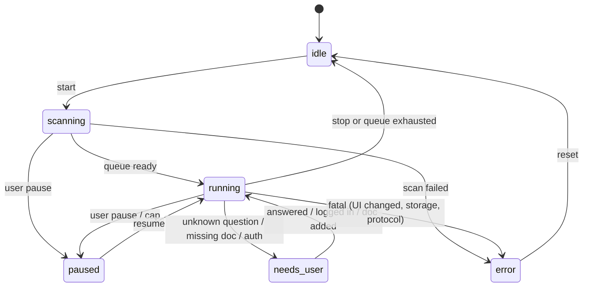
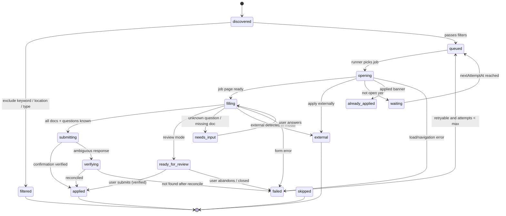
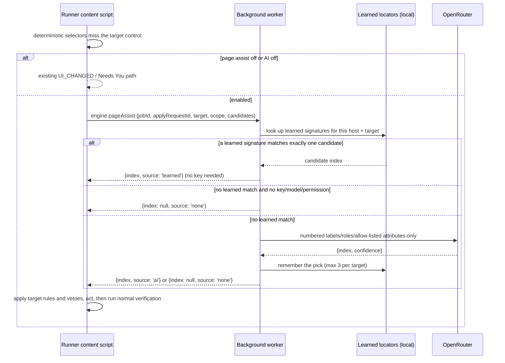

# Handshook Extension — Architecture

This document is the implementation reference for every agent. It defines runtime boundaries, module responsibilities, data flow, storage, state machines, and failure behavior. Contracts are frozen separately in [`docs/CONTRACTS.md`](./docs/CONTRACTS.md).

---

## 1. Principles

1. **One runtime.** The browser is the runtime. No Python, no native host, no separate Chrome profile.
2. **Use the user's session.** Same-origin requests from the content script carry cookies automatically. Never request the `cookies` permission, never read cookies, never store a password.
3. **UI application.** Drive the existing page controls; Handshake's page submits the form. Internal endpoint use is read-only job-detail enrichment. No direct application POST or token extraction is implemented.
4. **Automation by default, review as opt-out.** Autopilot is the default mode: the run clicks Apply, fills Handshake's application dialog and submits when every gate passes. Review mode, an explicit Dry run, and each safety switch are opt-outs. "Never guess" still holds: only a required question without a saved answer or a required document without an entered ID sends a job to Needs You.
5. **Never guess.** Unknown question, missing document, ambiguous submission → pause/Needs You.
6. **Write-ahead, verify, reconcile.** Every submission has an idempotency record before the click and a verification after it.
7. **Local-first.** No backend, no telemetry. AI is on by default but cloud use is entirely the user's own OpenRouter key and permission; without them, matching stays local and page assist uses only locally learned locators. Either can be turned off in Settings.
8. **Contracts before code.** Zod schemas are the boundary. No module invents its own shapes.
9. **One writer.** The background service worker is the only writer to IndexedDB. Content scripts and UI request writes through messages.
10. **Fail visibly.** Every failure has a typed code, a user-facing reason, and a retry decision.

---

## 2. Runtime and processes

| Context                           | Lifetime              | Responsibilities                                                                                |
| --------------------------------- | --------------------- | ----------------------------------------------------------------------------------------------- |
| **Side panel** (`sidepanel.html`) | While open            | UI, onboarding, settings, queue/activity display, answer entry, diagnostics export              |
| **Background service worker**     | Ephemeral (~30s idle) | Message router, engine state, queue, pacing, tab lifecycle, AI proxy, alarms, storage writes    |
| **Runner tab content script**     | While tab is open     | SPA route watching, discovery, job detail extraction, apply flow, DOM interaction, verification |
| **Other Handshake tabs**          | User-controlled       | Used only for session detection / "open Handshake" guidance; no automation                      |
| **IndexedDB**                     | Persistent            | Jobs, queue, events, answers, documents, AI cache, submissions                                  |
| **`chrome.storage.local`**        | Persistent            | Settings, engine state, onboarding progress, AI keys (local only)                               |

**Why the service worker is not the runner:** MV3 workers are killed after ~30s idle. A long apply loop must live in a tab. The service worker coordinates; the runner tab executes. `chrome.alarms` wakes the worker to resume/verify.

**Why the runner tab:** keeping a single, pinned, non-discardable tab gives a stable content script context, avoids interfering with the user's active tabs, and makes progress observable. The tab can be brought to the foreground during apply (default) or run in the background (option).

---

## 3. Stack

| Concern             | Choice                                         | Notes                                                                       |
| ------------------- | ---------------------------------------------- | --------------------------------------------------------------------------- |
| Extension framework | **WXT**                                        | MV3, typed entrypoints, side panel support, Vite HMR, future Firefox target |
| UI                  | **React 19 + TypeScript strict**               | Side panel only; no content-script UI in v1                                 |
| Styling             | **Tailwind CSS 4**                             | Local styles; no remote fonts/assets                                        |
| Contracts           | **Zod**                                        | Runtime validation at every message/storage/AI boundary                     |
| Storage             | **`chrome.storage.local` + IndexedDB (`idb`)** | Small state vs large history                                                |
| AI                  | Fetch (OpenRouter) + local heuristic           | No SDK dependency; provider interface                                       |
| Tests               | **Vitest + Playwright**                        | Unit/integration + extension E2E                                            |
| Package manager     | **npm**                                        | Lockfile committed                                                          |
| Lint/format         | **ESLint 9 flat config + Prettier**            | Strict TS rules                                                             |

No dependency may be added after T01 without integration approval. The goal is a small review surface and a small bundle.

---

## 4. Folder layout

```
extension/
├── src/entrypoints/
│   ├── background.ts                 # thin: register router, alarms, side panel behavior
│   ├── handshake.content.ts          # thin: register content router
│   └── sidepanel/
│       ├── index.html
│       ├── main.tsx
│       └── App.tsx                   # owned by T04; final wiring T30
├── src/
│   ├── core/
│   │   ├── contracts/                # T02 only: Zod schemas + inferred types
│   │   │   ├── job.ts
│   │   │   ├── queue.ts
│   │   │   ├── settings.ts
│   │   │   ├── answers.ts
│   │   │   ├── documents.ts
│   │   │   ├── messages.ts
│   │   │   ├── events.ts
│   │   │   └── index.ts
│   │   ├── storage/
│   │   │   ├── db.ts                 # T05 only: IndexedDB open/migrations
│   │   │   ├── migrations.ts         # T05 only
│   │   │   ├── settings.ts           # T05
│   │   │   ├── jobs.ts               # T10
│   │   │   ├── tracker.ts            # T10
│   │   │   ├── answers.ts            # T20
│   │   │   └── submissions.ts        # T12
│   │   ├── state/
│   │   │   └── engineStore.ts        # T05: persisted EngineState read/write
│   │   ├── orchestrator/
│   │   │   ├── engine.ts             # T12: state machine
│   │   │   ├── queue.ts              # T12
│   │   │   ├── reconcile.ts          # T12
│   │   │   ├── pacer.ts              # T11
│   │   │   ├── guards.ts             # T11
│   │   │   ├── tabs.ts               # T23
│   │   │   └── clock.ts              # T11: injectable clock
│   │   ├── answers/
│   │   │   ├── matcher.ts            # T20
│   │   │   ├── policy.ts             # T20: sensitive/EEO rules
│   │   │   └── normalize.ts          # T20
│   │   ├── filters/                  # T25
│   │   ├── scoring/                  # T25
│   │   ├── logging/                  # T24
│   │   │   ├── logger.ts
│   │   │   ├── redact.ts
│   │   │   └── eventStore.ts
│   │   ├── diagnostics/              # T24
│   │   │   ├── export.ts
│   │   │   └── health.ts
│   │   ├── migration/                # T33: legacy Python import
│   │   └── util/
│   │       ├── result.ts
│   │       ├── errors.ts
│   │       ├── time.ts
│   │       └── hash.ts
│   ├── background/
│   │   ├── router.ts                 # T05 stub, T30 wiring
│   │   ├── handlers/                 # T30
│   │   ├── alarms.ts                 # T05
│   │   └── sidePanel.ts              # T05
│   ├── content/
│   │   ├── bridge.ts                 # T06: typed messaging, timeouts, cancel
│   │   ├── lifecycle.ts              # T06: SPA URL watcher, unload
│   │   ├── router.ts                 # T06 stub, T30 wiring
│   │   └── runner.ts                 # T23: execute apply jobs in the tab
│   ├── handshake/
│   │   ├── host.ts                   # T08: host/origin parsing, URL builders
│   │   ├── dom.ts                    # T08: find/click/type/wait/native setter
│   │   ├── text.ts                   # T08: normalization, regex, fuzzy text
│   │   ├── health.ts                 # T08: selector health reporting
│   │   ├── selectors/
│   │   │   ├── index.ts              # T08 re-exports only
│   │   │   ├── discovery.ts          # T15
│   │   │   ├── job.ts                # T16
│   │   │   ├── apply.ts              # T18
│   │   │   ├── questions.ts          # T19
│   │   │   └── verification.ts       # T18
│   │   ├── discovery.ts              # T15
│   │   ├── jobDetails.ts             # T16
│   │   ├── applyType.ts              # T16
│   │   ├── documents.ts              # T17: application document picker only
│   │   ├── questions.ts              # T19
│   │   ├── answerMatcher.ts          # T20
│   │   ├── applyFlow.ts              # T18
│   │   ├── verification.ts           # T18
│   │   └── adapters.ts               # T30: registry wire-up
│   ├── ai/
│   │   ├── types.ts                  # T13
│   │   ├── matcher.ts                # T13
│   │   ├── heuristic.ts              # T13
│   │   ├── prompts.ts                # T13
│   │   ├── validate.ts               # T13
│   │   ├── cache.ts                  # T13
│   │   └── providers/
│   │       ├── openrouter.ts         # OR-1: user-selected cloud model
│   │       └── availability.ts       # T14: matcher availability
│   ├── ui/
│   │   ├── App.tsx                   # T04 shell; T30 final wiring
│   │   ├── router.ts                 # T04: view enum, no URL router
│   │   ├── theme.css                 # T04
│   │   ├── components/               # T04 only
│   │   ├── hooks/                    # T04 generic hooks; T21/T22 feature hooks
│   │   └── screens/
│   │       ├── Onboarding/           # T22
│   │       ├── Dashboard/            # T21
│   │       ├── Queue/                # T21
│   │       ├── Activity/             # T21
│   │       ├── NeedsYou/             # T22
│   │       ├── Settings/             # T22 (+ T33 ImportExportSection)
│   │       └── Diagnostics/          # T22 UI; T24 logic
│   └── test/
│       ├── fixtures/                 # synthetic + sanitized live fixtures
│       ├── factories/                # typed test data
│       └── setup.ts                  # Vitest setup
├── tests/
│   ├── unit/
│   ├── integration/
│   └── e2e/
├── docs/
├── orchestration/
├── src/public/
├── wxt.config.ts
├── package.json
├── tsconfig.json
├── eslint.config.js
├── vitest.config.ts
└── playwright.config.ts
```

---

## 5. Contracts and message protocol

All shared types live in `src/core/contracts/` and are validated with Zod. Full definitions: [`docs/CONTRACTS.md`](./docs/CONTRACTS.md).

**Rules:**

- Every message has `type`, `requestId` (request), and a typed response.
- Background validates every inbound message; content/UI validate every response.
- Unknown message types are rejected with `UNSUPPORTED_MESSAGE`.
- Message handlers must be idempotent where the operation mutates state.
- Use `Result<T>` rather than throwing across context boundaries.
- Protocol version is checked at startup; mismatch → `PROTOCOL_MISMATCH` and UI prompt to reload the extension.

**Message groups:**

| Group             | Direction               | Examples                                                                     |
| ----------------- | ----------------------- | ---------------------------------------------------------------------------- |
| `ui.*`            | side panel → background | `ui.engine.start`, `ui.queue.list`, `ui.answer.save`, `ui.settings.update`   |
| `content.*`       | background → content    | `content.scan`, `content.apply`, `content.cancel`, `content.detectSession`   |
| `content.event.*` | content → background    | `content.event.progress`, `content.event.needsInput`, `content.event.result` |
| `state.*`         | background → side panel | `state.changed`, `queue.changed`, `event.appended`, `needs.you`              |

---

## 6. Storage design

### 6.1 `chrome.storage.local`

| Key                         | Contents                                       | Notes                                                             |
| --------------------------- | ---------------------------------------------- | ----------------------------------------------------------------- |
| `handshook.settings.v1`     | `Settings`                                     | No secrets; includes OpenRouter model/routing choices             |
| `handshook.engine.v1`       | `EngineState`                                  | Persisted for service-worker restarts                             |
| `handshook.onboarding.v1`   | onboarding progress                            | Small                                                             |
| `handshook.ai.keys.v1`      | `{openRouterApiKey?: string}`                  | Isolated, unencrypted local storage; never synced/exported/logged |
| `handshook.ai.migration.v1` | `{geminiReplaced: boolean, notified: boolean}` | One-time provider-change notice; no credentials                   |

Do **not** store job history, descriptions, events, or answers in `chrome.storage.local`; use IndexedDB.

### 6.2 IndexedDB `handshook`

Version 1 stores:

| Store         | Key     | Indexes                                      | Purpose                                                                    |
| ------------- | ------- | -------------------------------------------- | -------------------------------------------------------------------------- |
| `jobs`        | `id`    | `byHost`, `byDiscoveredAt`, `byApplyType`    | Job details, description, fit score                                        |
| `queue`       | `jobId` | `byStatus`, `byUpdatedAt`, `byNextAttemptAt` | Queue state machine                                                        |
| `events`      | `id`    | `byAt`, `byJobId`, `byLevel`                 | Append-only activity log (cap 5,000)                                       |
| `answers`     | `id`    | `byUpdatedAt`, `bySensitive`                 | Reusable answer bank                                                       |
| `documents`   | `id`    | `byType`                                     | Legacy document records; no longer written (documents are manual settings) |
| `aiCache`     | `key`   | `byCreatedAt`                                | SHA-256 → match result (cap 2,000)                                         |
| `submissions` | `id`    | `byJobId`, `byCreatedAt`                     | Write-ahead/idempotency records                                            |
| `meta`        | `key`   | —                                            | Schema version, install ID, last reconcile, learned page-assist signatures |

**Write policy:** background is the only writer. Content/UI send commands. Use a single `withDb()` helper and transactions for multi-store writes (e.g., queue + submission + event).

**Quota handling:** catch `QuotaExceededError`; prune events/AI cache first, then old skipped/failed jobs. Never prune `applied` or `submissions` without explicit user action.

**Migrations:** versioned array in `migrations.ts`; run before engine start; write result to `meta`. If migration fails, set engine `error` with `STORAGE_MIGRATION_FAILED`; do not proceed.

---

## 7. Engine state machine



**EngineState fields:** status, mode, host, startedAt, pausedAt, currentJobId, todayCount, dailyCap, consecutiveFailures, lastError, message, version.

**Start preconditions:**

1. Onboarding complete enough (host, at least one resume, mode chosen).
2. Session is logged in (detected by content script; if not, UI shows "Open Handshake and log in").
3. No other engine run is active.
4. Storage migration succeeded.
5. Daily cap not reached (or user explicitly overrides? No override in v1).

**Pause reasons:** `user`, `cap_reached`, `auth_required`, `rate_limited`, `ui_changed`, `too_many_failures`, `tab_closed`, `storage_error`. Legacy `active_hours` pauses become user pauses with immediate Resume availability on load.

**Resume behavior:** reload state, reconcile submissions, re-check session, then continue from the queue. Never restart from page 1 unless the queue is empty.

---

## 8. Job lifecycle



**Terminal statuses:** `applied`, `external`, `already_applied`, `skipped`, `filtered`, `blocked`.
**Retryable statuses:** `failed` (max 2 attempts), `waiting` (until open date), `needs_input` (after answer).

`ready_for_review` is produced only when the user enables Review; on the default
Autopilot path a filled form proceeds to `submitting` once every gate passes.

**Dedup key:** `${host}:${jobId}`. If imported from Python as `applied`, never reprocess.

---

## 9. Discovery flow

```
Start / Scan
  → runner tab opens saved search URL (or current search page)
  → content script detects page type
  → extract job cards:
      - anchors matching /jobs/(\d+) or /stu/jobs/(\d+)
      - data-job-id / data-testid hints
      - title, employer, location from card text
  → dedupe by host+id
  → upsert Job records (source=search)
  → click Next / navigate page=N up to maxPagesPerRun
  → delay 1.5–3s between pages
  → background filters + scores
  → enqueue passing jobs
```

**Rules:**

- Prefer reading the rendered page over reverse-engineering search XHR.
- Handle SPA navigation: content script watches `location.href` and re-runs the page adapter.
- Do not scroll aggressively or click job cards to "warm up" the session; that is bot-like and unnecessary.
- Stop after `maxPagesPerRun` (default 3) and `maxJobsPerRun` (default 100).
- If a page yields zero jobs and the selector was expected to match, report `UI_CHANGED` after 2 consecutive pages.
- Preserve job order; scoring decides apply order.

**Job details:**

- Primary: DOM on `/jobs/{id}` — title, employer, description, location, apply button label, applied banner.
- Secondary: `GET /stu/jobs/{id}` (same-origin fetch) — `job_apply_setting.apply_type`, `required_job_document_types`, `apply_start`, description.
- If API 403/422, continue with DOM.
- `applyType`: `quick_apply` if button text matches Quick Apply; `handshake_form` if Apply; `external` if Apply Externally; `unknown` otherwise.
- If `apply_start` is in the future → `waiting` with `nextAttemptAt`.

---

## 10. Apply flow

```
Autopilot is the default; Review and Dry run are opt-outs.
background selects job
  → runner tab navigates to /jobs/{id}
  → content extracts details, verifies not applied/closed
  → classify apply type
  → write submission attempt (status=started) BEFORE clicking
  → click Apply / Quick Apply / Apply externally
      handshake_form (live 2026-10-28: a plain "Apply" button with no aria-haspopup):
          → click Apply
          → wait for the application dialog: heading "Apply to <Employer>",
            "Attach your resume" (an already-selected card), "Attach your cover letter"
            (a search input with placeholder "Search your cover letters"), and the
            footer button "Submit Application"
          → resume: check the preselected card against the chosen ID when its markup
            exposes it; when it cannot be confirmed or differs, use the picker
            (search input → combobox → hidden select)
          → cover letter / transcript / other: use the field's search picker or
            combobox; type the user's name only when one exists; select the exact ID
          → detect screening questions → match saved answers
          → if a required question has no saved answer, or a required document has no
            entered ID → needs_input, DO NOT submit
          → review mode (opt-out): fill, mark ready_for_review, keep the dialog open
          → autopilot: require no unknown required question, no missing required
            document, and no visible validation error, then click Submit Application
      quick_apply:
          → click → wait for confirmation → verify (requires allowOneClickApply)
      external:
          → do not click through blindly
          → mark external; open employer site in a new tab with instructions
  → verify success:
      - confirmation banner "You applied on ..."
      - button state changes to Applied
      - toast with success
      - absence of validation errors
  → update submission attempt (status=applied/failed/ambiguous)
  → update queue/tracker/events
  → wait pacer delay before next job
```

**Control discovery.** Each control (Apply, Submit Application, resume/cover-letter/
transcript/other document field) is resolved by the deterministic selector strategies
first. If a required control cannot be found and AI page assist is enabled with an
OpenRouter key, the apply flow calls `assistLocate` and asks the background for a pick
(see the page-assist sequence in §13). Page assist may only choose _which control_ to
use; it never chooses answers, documents, or whether to submit, and the dialog/document/
confirmation verification above still runs.

**Write-ahead record:**

```ts
interface SubmissionAttempt {
  id: string; // uuid
  runId: string;
  jobId: string;
  host: string;
  startedAt: number;
  finishedAt?: number;
  capCountedAt?: number; // durable once-only reservation for confirmed/uncertain sends
  status: 'started' | 'submitted' | 'applied' | 'failed' | 'ambiguous';
  applyType: ApplyType;
  documents: DocumentsUsed; // selected IDs, or 'handshake_profile_defaults'
  questionIds: string[];
  confirmationText?: string;
  error?: AppError;
  reconciledAt?: number;
  reconciliationNote?: string;
}
```

**On restart:** any `started`/`submitted`/`ambiguous` record triggers reconciliation before the job can be retried:

1. Open the job page; look for "You applied on".
2. Check My Jobs/application state if available.
3. If applied → mark `applied`; if not → mark `failed` with `needs_review` (do not auto-retry a possibly-submitted job without user confirmation).
4. Record the reconciliation reason in events.

**Review-mode handoff (opt-out):** when the user enables **Review before submitting**,
the dialog is filled and left open in the runner tab. The side panel shows "Review in
tab" and watches for confirmation. If the user submits, the content script detects the
banner and marks applied. If the user navigates away, mark `ready_for_review` and keep it
in the queue for manual completion.

---

## 11. Screening questions and answer bank

Screening questions can be yes/no, select, radio, text, date, or number. Some are attestations (work authorization, sponsorship); some are EEO/demographic; some are free text. Do not assume a fixed platform question limit.

**Detection:**

- Find visible form controls inside the application modal/dialog, grouped by `fieldset`, `label`, `legend`, `aria-labelledby`, or surrounding text.
- Normalize label text: lowercase, collapse whitespace, strip punctuation/required markers.
- Build `QuestionDescriptor` with a stable fingerprint (`sha256(normalizedLabel + type + optionLabels)`).
- Ignore hidden inputs, disabled controls, and the document comboboxes (handled separately).
- Detect required state from `required`, `aria-required`, asterisk, or "required" text.

**Matching:**

1. Exact fingerprint in per-job cache.
2. Exact normalized label in answer bank.
3. Alias match.
4. Token overlap / Levenshtein above threshold.
5. Type compatibility check (never put a text answer into a radio).
6. Confidence below threshold → `unknown`.

**Policies:**

- Work authorization / sponsorship / felony / veteran / disability / gender / race / ethnicity are **sensitive**.
- Saved answers are used automatically by default. A new non-sensitive answer is created auto-submittable; a sensitive answer follows `allowSensitiveAutoSubmit` (on by default). Each answer still carries its own `autoSubmitAllowed`, so the user can mark one as not-automatic, and the global sensitive/EEO/free-text switches remain individual opt-outs. An answer that is not auto-submittable stays blank in Autopilot and waits in Needs You.
- EEO questions default to "Prefer not to answer" only if that option exists; otherwise Needs You. Never infer.
- Free-text answers are never auto-generated in v1. AI may suggest in Needs You, but requires approval.
- A per-job answer can be saved without changing the global bank.
- "Remember this answer" updates the bank; otherwise it applies only to the current job.

**Needs You payload:** job title/employer, question label/help text, type, options, current value, suggested answer (if any), screenshot reference, and actions: Save & continue, Skip job, Stop run.

---

## 12. Documents

**Manual entry only.** The user opens their Handshake documents page from setup or
**Settings → Documents** (`handshakeLinks(settings.host).documents`, a normal new tab
through `ExternalLink`), opens a document, and pastes its link
(`https://app.joinhandshake.com/docs/12345678`) or bare ID. `parseHandshakeDocumentId`
accepts a bare ID (`[A-Za-z0-9_-]{1,64}`) or a Handshake `/docs/<id>` (or
`/documents/<id>`) link, and settings store only the parsed ID plus the name the user
typed. Invalid input is rejected, and a cleared settings field is `undefined`.

- Slots: default resume, optional cover letter, transcript, and other document.
- Up to `MAX_ADDITIONAL_RESUMES` (5) named additional resumes
  (`additionalResumes: { id, name }[]`) that AI matching or per-job choices may use.
- Handshook never reads, lists, paginates, refreshes, or caches the documents page.
  There is no document store write, freshness timestamp, collection message, or page
  adapter for it.
- `configuredDocuments(settings.documents, override?)` is the only source of available
  documents: default resume first (`isDefault: true`), then additional resumes, then
  the optional attachments. An ID present only in a per-job override is included with
  an empty title so it can be validated.

The dialog's resume slot usually shows an already-selected card (check icon, file name,
a **Preview document** link, and an **×** remove button). Handshook verifies that card's
document ID when the markup exposes it; when it differs from the choice, the picker
strategies below select the exact ID. The cover-letter slot is a search input whose
placeholder is **Search your cover letters**; transcript and other document fields use
the same strategies.

**Selection strategies (application modal):**

1. Search input/combobox → click, open, and type the user's name only when one exists;
   pick the option whose ID matches.
2. React combobox/listbox → open, find the option whose ID matches.
3. Hidden/native `<select>` → set the ID value, dispatch `change`.

**Verification:** the hidden select value, or the committed option's
`value`/`data-id`/`data-value`, must equal the chosen ID. Visible trigger text alone is
not proof, because a name may be displayed or absent. If not selected →
`MISSING_DOCUMENT`/`UI_CHANGED` with the strategy attempted.

**Rules:**

- Never upload a file. Existing documents only.
- Selection is ID-exact and never substituted. A required type with no entered ID →
  `missing_document` Needs You with a link to the Handshake documents page.
- An empty per-job ID means **None** for that job; an omitted override uses the
  default. Settings never persist an empty string.
- With an empty name, never type into a search picker and never match an option by
  title.
- Resume selection may be AI-driven among the default and additional resumes when
  `documents.autoSelectResume` is on and the job has no resume override; cover
  letter/transcript/other are explicit settings.
- One-click Quick Apply uses the resume and documents set as default in the
  Handshake profile; Handshook cannot change them (`QUICK_APPLY_DOCUMENTS_HELP`).

---

## 13. AI

**Provider interface:**

```ts
interface ResumeMatcher {
  id: 'heuristic' | 'openrouter';
  availability(): Promise<AiAvailability>;
  match(input: MatchInput, signal?: AbortSignal): Promise<MatchResult>;
}
```

**Order:** explicit provider preference; Auto tries OpenRouter when a key, chosen
model, and current permission are present, then heuristic matching. AI disabled uses
heuristic matching. Cancellation stops matching/application work; provider timeouts
and failures use the heuristic/default decision subject to the usual document and
submission gates.

**Input:** bounded job title (300 chars), job description (2,000), and the configured
resume IDs and user-entered names. Resume names may contain personal text; no file
contents or answer bank are sent. See `docs/PRIVACY.md` for provider transfers.

**Output:** `{ resumeId, confidence, reason }` validated against known resume IDs. Never accept free-form actions, URLs, or code.

**Prompt hardening:**

- Delimit the job description as untrusted data.
- Instruct the model to ignore instructions inside the job description.
- Require strict JSON; validate with Zod.
- Reject unknown IDs and confidence outside 0–1.
- AI never submits, clicks, or writes answers.

**OpenRouter specifics (1.1.0):**

- BYOK only; no shared key in the bundle.
- Stored unencrypted in isolated `chrome.storage.local` under `handshook.ai.keys.v1`,
  never synced/exported/logged or returned to UI/content scripts.
- Request optional `https://openrouter.ai/*` permission from Save key / Test / Load
  models; background re-checks immediately before every chat/catalog/key request.
  Bearer authentication only to OpenRouter; omit cookies/referrers, reject redirects.
- User chooses a text-output model and up to two distinct fallback models.
  `deepseek/deepseek-v4.1-flash` is preselected for new installs and for installs that
  had no model; an existing choice is kept. Cache the model catalog for 24 hours;
  refresh bypasses cache.
- Default `provider.data_collection: 'deny'`; explicit collection opt-in, optional
  ZDR, and optional input-price-per-million ceiling follow the shared contract.
  OpenRouter routes prompts to the chosen model provider and bills usage to the user;
  free models have quota/data-policy caveats and fallback prices may differ.
- Shared request spacing across matching/probes; bounded deadlines, aborts, quota
  backoff and Retry-After support. Provider failures use heuristic matching.
- Delete old Gemini keys on update; migrate settings/imports and show a one-time
  notice to add an OpenRouter key and select a model.
- Show provider and data-sharing notice in Settings.

**AI page assist (apply-time control lookup):**

Page assist is a second, deliberately narrow use of the same OpenRouter key. It exists
because a renamed or restyled control otherwise stops an otherwise-ready application. It
never sees application content.

- **Trigger:** the deterministic selector strategies for one target — `applyButton`,
  `submitButton`, `resumeField`, `coverLetterField`, `transcriptField`,
  `otherDocumentField` — found nothing, and `ai.enabled`, `ai.pageAssist`, a model, and
  the current permission are present. Otherwise the existing `UI_CHANGED` / Needs You
  path runs unchanged.
- **Payload:** at most 80 candidates from the job page or the open dialog. Each carries
  `index`, `tag`, `role`, `type`, a short accessible `name`, up to 120 characters of
  visible `text`/`placeholder`/nearest `context`, `inDialog`, `disabled`, and only these
  attribute names: `aria-haspopup`, `aria-expanded`, `aria-label`, `data-hook`,
  `data-testid`, `data-kind`, `data-variant`, `data-size`, `name`. Input values are never
  read, and emails, phone numbers and 7+ digit runs are masked before sending. It
  contains no field values, answers, document contents, `href`s, or page URLs.
- **Answer:** one candidate index (or none) plus `source: 'learned' | 'ai' | 'none'` and
  an optional confidence. The background validates the index against the same candidate
  list and treats a confidence below 0.7 as not found; it does not execute or forward
  anything from the model. The request is bounded at 20 seconds.
- **Vetoes in the content script:** a picked control must also fit its target — an Apply
  control outside the dialog and button-like, a Submit control inside the dialog and
  button-like, a document field inside the dialog and picker/combobox/select/search-like —
  and its text/label must not match destructive or unrelated intent: withdraw, delete,
  remove, cancel, upload, close/back, sign out, save, share, preview, and similar.
  Vetoed picks are treated as "not found".
- **Verification:** every normal check still runs — document ID verification, submit
  authorization bound to the exact attempt, no unknown required question, no visible
  validation error, and positive post-submit confirmation.
- **Memory:** the background remembers a model pick — the three most recent per target and
  Handshake host, as a tag/role/normalized-name/attribute signature — and matches it
  before any network call, so the next job with the same markup needs no AI call. A
  learned match is a shortcut only: it is re-checked against the payload rules and the
  content script's vetoes every time. Learned locators are local records and never part of
  a prompt.



The exact candidate, request, and answer schemas are in
[CONTRACTS.md](./docs/CONTRACTS.md#10-ai-contracts).

The exact request, catalog, migration, and RPC shapes are in
[CONTRACTS.md](./docs/CONTRACTS.md#10-ai-contracts).

**Cache key:** SHA-256 of structured provider/model/prompt-version identity, job text and sorted resume ID/name metadata. Lookup follows provider preference; fallback responses are stored under the responding model. Writes retain at most 2,000 entries.

---

## 14. Pacing and guardrails

Defaults:

| Setting                  | Default      | Rationale                                      |
| ------------------------ | ------------ | ---------------------------------------------- |
| Min delay                | 60s          | Human-like; current tool uses 60–120s          |
| Max delay                | 120s         | Same                                           |
| Jitter                   | ±10%         | Avoid exact cadence                            |
| Daily cap                | 25           | Conservative; well below Handshake's 300 block |
| Hard cap                 | 100          | Never allow a single day near 300              |
| Session batch            | 10           | Break after 10 applications                    |
| Session break            | 5–10 min     | Human-like pause                               |
| Active hours             | Unrestricted | Runs may start and continue at any hour        |
| Max consecutive failures | 3            | Stop a broken run                              |
| Max attempts/job         | 2            | Prevent loops                                  |
| Discovery page delay     | 1.5–3s       | Page navigation, not applications              |

**Stop conditions:**

- daily cap / hard cap reached
- 3 consecutive failures
- auth required
- 429/403 after backoff
- selector health failure threshold (UI changed)
- tab closed / storage error / protocol mismatch
- user pause/stop

**Backoff:** 2^consecutiveErrors, capped at 16× for delays; honor `Retry-After` if present; pause engine after 3 rate-limit signals.

**Clock:** injectable (`clock.now()`, `clock.sleep()`), so tests are deterministic and no production path depends on real timers.

**No parallelism:** one job at a time, one runner tab. Never open multiple apply tabs.

---

## 15. Runner tab and SPA lifecycle

- Create with `chrome.tabs.create({ url, active: true })`; pin via `chrome.tabs.update({ pinned: true })`; set `autoDiscardable: false`.
- Reuse the existing runner tab if present; navigate it instead of creating duplicates.
- Track `tabId` in `EngineState`; validate on every operation.
- On tab close: pause with `tab_closed`; offer Resume (which recreates the tab).
- On discard: recreate/navigate; content script re-injects.
- On login redirect: pause with `auth_required`; do not automate SSO.
- On Chrome restart: service worker starts, reads state; if a run was active, set `paused` with `browser_restarted`; user resumes.
- SPA route watcher: poll `location.href` every 500ms in the content script, plus `popstate`; debounce 150ms; dispatch route changes to the page router.
- Content script must tolerate being injected multiple times (idempotent guard on `window`).
- On injection after a full navigation, the content script asks the background for a pending command for its tab/job and resumes it. A page load must not lose the current step.
- **Timers:** background-tab `setTimeout` is throttled. Use `chrome.alarms` (minimum 30s) for pacing waits longer than 30s, and content-script timers only for short UI waits (1–10s). The runner tab is active by default to avoid throttling; background mode is best-effort and must not break correctness.
- **Iframes/shadow DOM:** if the application modal lives in an iframe/shadow root, the spike must record it; T08 provides deep-query helpers and the content script may need `all_frames` scoped to the modal. Do not add `all_frames` globally without evidence.

**Why a dedicated tab:** the application modal is stateful; navigation in the user's tab would be disruptive. The runner tab is visible, pinned, and under the extension's control.

---

## 16. UI

Single side panel, no popup. Toolbar action opens the panel via `sidePanel.setPanelBehavior({ openPanelOnActionClick: true })`.

Screens:

| Screen      | Contents                                                                    | Owner                  |
| ----------- | --------------------------------------------------------------------------- | ---------------------- |
| Onboarding  | Login check, host, documents, answers, search prefs, mode                   | T22                    |
| Dashboard   | Status, Start/Pause, today's count/cap, current job, next up, warnings      | T21                    |
| Queue       | Ranked jobs, status chips, fit score/why, actions (review/skip/retry)       | T21                    |
| Needs You   | Unanswered questions, missing docs, auth, UI-changed; answer once and reuse | T22                    |
| Activity    | Reverse-chronological events, filters, copy/export                          | T21                    |
| Settings    | Search, pacing, documents, answers, AI, advanced, danger zone               | T22                    |
| Diagnostics | Version, host, storage, selector health, recent errors, export              | T22 (UI) + T24 (logic) |

**UI state:** background is the source of truth. The panel calls `ui.engine.getState` on mount, then subscribes to `state.changed`, `queue.changed`, `event.appended`, `needs.you`. Zustand may hold transient view state only.

**Design constraints:**

- Width 320–480px; no horizontal scroll.
- System fonts; no remote assets; no Handshake logo/trademark.
- Accessible: labeled controls, focus rings, keyboard navigation, `aria-live` for status, color contrast AA.
- Clear destructive actions (reset, delete data) with confirmation.
- No dark patterns; Stop always visible during a run.
- Empty states explain the next action.
- Errors include a reason and a recovery action; never a raw stack trace.

---

## 17. Failure taxonomy

| Code                       | Meaning                               | Retry?                   | UX                                         |
| -------------------------- | ------------------------------------- | ------------------------ | ------------------------------------------ |
| `AUTH_REQUIRED`            | Session expired/logged out            | No, until login          | Pause + "Log in to Handshake"              |
| `RATE_LIMITED`             | 429 or explicit limit                 | Backoff                  | Pause after N; show wait                   |
| `FORBIDDEN`                | 403/CSRF/blocked                      | Backoff, then stop       | Pause + diagnostics                        |
| `CHALLENGE`                | Cloudflare/CAPTCHA/human verification | No, until user completes | Pause + "Complete verification in the tab" |
| `CAP_REACHED`              | Daily/hard cap                        | Next day                 | Stop with count                            |
| `EXTERNAL_APPLY`           | Employer ATS                          | No                       | Handoff card with link                     |
| `MISSING_DOCUMENT`         | Required doc absent                   | After user adds          | Needs You                                  |
| `UNKNOWN_QUESTION`         | No confident answer                   | After user answers       | Needs You                                  |
| `UI_CHANGED`               | Expected element missing repeatedly   | No                       | Pause + selector health                    |
| `NETWORK` / `TIMEOUT`      | Transient                             | Up to 2                  | Retry with backoff                         |
| `ALREADY_APPLIED`          | Existing application                  | No                       | Terminal applied                           |
| `JOB_CLOSED`               | Posting closed                        | No                       | Terminal skipped                           |
| `NOT_OPEN`                 | Apply start in future                 | At `nextAttemptAt`       | Waiting                                    |
| `CANCELLED`                | User/engine cancel                    | Manual                   | Idle                                       |
| `STORAGE_MIGRATION_FAILED` | DB migration                          | No                       | Error + export/reset                       |
| `PROTOCOL_MISMATCH`        | Old content/UI                        | Reload                   | Prompt reload                              |
| `UNKNOWN`                  | Unclassified                          | Once                     | Failed + diagnostics                       |

---

## 18. Logging, diagnostics, privacy

- Structured `JobEvent` records: `at`, `level`, `type`, `jobId?`, `message`, `data?`.
- Event log capped at 5,000; older events pruned, applied history retained separately.
- Redaction: remove API keys, cookies, emails, phone numbers, tokens, and full descriptions from logs; job title/employer allowed.
- Selector health: record strategy name, success/failure, page type, timestamp; aggregate in diagnostics.
- Shareable diagnostics uses explicit versioned allowlists for status/error codes, settings flags, counters, times and aggregated selector metrics; personal text, search URLs, tenant hosts and identifiers are removed. Unknown fields/codes stay excluded. Private backups and CSV retain personal records and scrub credentials; never attach them to public support reports.
- No network telemetry. User copies/exports manually.
- IndexedDB is not encrypted at rest. No passphrase-encryption feature is implemented in 1.1.0.
- `innerHTML` is forbidden for job content. Use `textContent`/React escaping. Sanitize any HTML from job descriptions before rendering (v1: render as plain text).

---

## 19. Testing strategy

See [`docs/TESTING.md`](./docs/TESTING.md) for the full matrix.

| Layer           | Tool                          | Scope                                                                                            |
| --------------- | ----------------------------- | ------------------------------------------------------------------------------------------------ |
| Unit            | Vitest                        | Pure logic: tracker, pacer, filters, answer matching, AI validation, URL/host parsing, redaction |
| DOM integration | Vitest + jsdom/happy-dom      | Selector adapters, question detection, document selection, React input events, fixtures          |
| Extension E2E   | Playwright (bundled Chromium) | Side panel + background + content + mock Handshake, full flows                                   |
| Live smoke      | Manual, user-owned            | 1 review application, then 1 safe autopilot; never in CI                                         |

**Mock Handshake:** Playwright route interception for `https://app.joinhandshake.com/**`, serving fixture HTML/JSON. Set a fake session cookie for realism (content script still detects login via DOM, not cookies). Scenarios: quick apply, modal (1 doc, 3 docs), screening questions (radio/select/text), external, already applied, closed, 429, 403, login redirect, SPA nav, missing selector.

**No agent may run against the live site.** Live smoke is user-driven and capped.

---

## 20. Extensibility

- **External ATS autofill** (v2): add a `hosts/` adapter layer for Workday/Greenhouse/Lever/Ashby. Keep the application engine generic; do not contaminate the Handshake adapter.
- **Firefox** (v2): WXT supports it; side panel → sidebar; test before claiming support.
- **Backend** (optional): AI proxy/sync behind a feature flag; local-first remains the default.
- **Additional job boards** (LinkedIn/Indeed): not in scope; the discovery/apply adapter interfaces should make it possible without rewriting the engine.
- **Team/career-center mode**: not in scope; would require consent and data governance.

---

## 21. Hard constraints from the current system

These are non-negotiable behaviors discovered in the Python code and Handshake docs:

1. The Python CLI's terminal application path was `POST /jobs/{id}/applications` with `{"application":{"applicable_id":id,"applicable_type":type,"document_ids":[...]},"work_authorization_status":null}`. This is recorded only as legacy context: it is unverified against today's site, cannot answer the dialog's questions, and skips the document selection the user configured. The extension does not implement it (see [ADR-020](./docs/DECISIONS.md#adr-020--full-automation-by-default-with-ai-page-assist)).
2. Document type IDs: resume=1, cover letter=2, transcript=3, other=5.
3. `apply_type` `"handshake"` means internal; anything else is external.
4. `apply_start` in the future means waiting.
5. Job IDs are numeric strings; the old extractor filtered `< 10M` — the extension should validate by URL context, not a magic threshold (spike will confirm).
6. Handshake's own docs: 300 applications/day → account block; Quick Apply vs Apply vs Apply Externally; up to 3 mandatory screening questions.
7. Cookie names used by the old tool (`_session_id`, `_trajectory_session`, `production_current_user`) are **not** to be read by the extension; session detection is DOM/API-based.
8. The old tool's hardcoded work-auth "Yes" and sponsorship "No" are unsafe. The extension requires explicit user answers.

---

## 22. Open architecture questions (resolve in spike)

1. ~~Exact document discovery path/API and whether the profile documents page is stable.~~ Resolved: documents are entered manually; the page is never read.
2. Exact search pagination control and whether `/postings` vs `/job-search` differ by school.
3. Quick Apply confirmation DOM and whether it opens a modal on some tenants.
4. Screening-question DOM patterns (label/legend/aria) across tenants.
5. External apply popup behavior and whether required docs/questions appear before redirect.
6. My Jobs path/response for reconciliation.
7. Whether `/stu/jobs/{id}` is available on all school hosts or only some.
8. Whether the application modal is a React portal outside the main app root.

These are captured in [`docs/SPIKE.md`](./docs/SPIKE.md) before apply-flow selectors are finalized.
