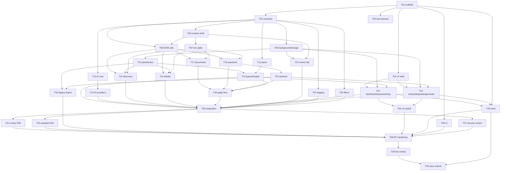

# Task Board & Multi-Agent Execution Plan

**Status (2026-10-27):** implementation exists; HX hardening and release validation
are in progress. This board records the original build tasks, not live worker state.
`done` means the baseline implementation is present, not that its current behavior
has passed every new audit finding. T37/T38 are reopened for final security/release
review; T07 is partially evidenced, and T39/T40 still need owner action.
**Model:** all implementation agents use `opencode-go/deepseek-v4.1-flash`.
**Concurrency:** 6–7 agents at peak. Do not exceed the wave limits.
**Workspace:** same repo. Agents use **disjoint file ownership only**. No git operations, no concurrent `npm install`, no live Handshake calls.

---

## How to use this board

1. Integration reads the wave, picks the next task, and spawns **one agent per task** with the brief from [`AGENTS.md`](./AGENTS.md).
2. The agent implements only within `Owns`, adds tests, runs the listed commands, and writes `.handoffs/<TASK_ID>.md`.
3. A review agent (fresh context) checks acceptance and returns a numbered issue list.
4. Integration fixes glue, runs the full wave suite, updates the status below, and commits.
5. Only then does the next wave start.

**Status legend:** `todo` · `in_progress` · `review` · `blocked` · `done`

The statuses in [`orchestration/tasks.yaml`](./orchestration/tasks.yaml) mirror the
task tables here. Original wave/model/shared-file rules below are historical build
instructions; the current HX dispatch brief governs the hardening worktrees.
See [STORE.md](./docs/STORE.md#release-checklist) for the current release gates and
[HX-09](../docs/hardening/HX-09.md) for the status reconciliation.

**Port tasks:** for anything marked "port" or "preserve behavior" (T15–T20, T33), read [`docs/PORT-NOTES.md`](./docs/PORT-NOTES.md) before implementing and confirm parity in the handoff.

## Wave overview

| Wave | Tasks                        |       Agents | Notes                                    |
| ---- | ---------------------------- | -----------: | ---------------------------------------- |
| 0a   | T01                          |            1 | Scaffold first; nothing else starts      |
| 0b   | T02, T03, T04                |            3 | Contracts, tests, UI shell               |
| 0c   | T05, T06                     |            2 | Background + content shells              |
| 0d   | T07, T08                     | 2 (one user) | Live capture + DOM utilities             |
| 1a   | T10, T11, T13, T23, T24, T25 |            6 | Core modules with no live-DOM dependency |
| 1b   | T12, T14, T15, T16, T17, T19 |            6 | Engine, providers, DOM adapters          |
| 1c   | T20, T21                     |            2 | Answers + dashboard/queue/activity       |
| 1d   | T18, T22                     |            2 | Apply flow + onboarding/settings/needs   |
| 2a   | T30                          |            1 | Integration wiring                       |
| 2b   | T31–T37                      |            7 | E2E, import, polish, CI, store, security |
| 3a   | T38                          |            1 | Release-candidate hardening              |
| 3b   | T39 → T40                    |     1 + user | Live smoke, then submission              |

**Start rule:** a task may start only when every entry in its `Depends` is `done`. Wave labels are capacity groups; they never override dependencies. If a dependency slips, move the task, don't start it blocked.

---

## Shared-file locks

Only the listed owner may edit these. Feature agents request changes in their handoff.

| File / area                                                                                                                                           | Owner                                                  |
| ----------------------------------------------------------------------------------------------------------------------------------------------------- | ------------------------------------------------------ |
| `package.json`, `package-lock.json`, `wxt.config.ts`, `tsconfig*.json`, `eslint.config.js`, `.prettierrc`, `vitest.config.ts`, `playwright.config.ts` | T01                                                    |
| `src/public/**`                                                                                                                                       | T01 (placeholder icons) → T35 (final assets)           |
| `src/entrypoints/sidepanel/**`                                                                                                                        | T01 (stub) → T04 (shell)                               |
| `src/entrypoints/background.ts`                                                                                                                       | T01 (stub) → T05 (bootstrap) → T30 (final wiring)      |
| `src/entrypoints/handshake.content.ts`                                                                                                                | T01 (stub) → T06 (runtime) → T30 (final wiring)        |
| `src/core/contracts/**`                                                                                                                               | T02 (integration may update after approval)            |
| `src/core/storage/db.ts`, `migrations.ts`, `settings.ts`, `src/core/state/engineStore.ts`                                                             | T05                                                    |
| `src/background/router.ts`                                                                                                                            | T05 (stub) → T30 (final wiring)                        |
| `src/content/bridge.ts`, `lifecycle.ts`                                                                                                               | T06                                                    |
| `src/content/router.ts`                                                                                                                               | T06 (stub) → T30 (final wiring)                        |
| `src/ui/App.tsx`, `src/ui/router.ts`, `src/ui/components/**`, `src/ui/theme.css`                                                                      | T04 → T30 (App wiring) → T34 (polish)                  |
| `src/ui/screens/**`                                                                                                                                   | T04 (stubs) → T21/T22 (feature screens) → T34 (polish) |
| `src/handshake/selectors/index.ts`                                                                                                                    | T08 (re-exports only)                                  |
| `src/handshake/selectors/<feature>.ts`                                                                                                                | T08 (stub) → T15/T16/T17/T18/T19 (owner per feature)   |
| `src/core/orchestrator/engine.ts`, `queue.ts`, `reconcile.ts`                                                                                         | T12                                                    |
| `src/handshake/applyFlow.ts`, `verification.ts`                                                                                                       | T18                                                    |
| `TASKS.md`, `.handoffs/WAVE-*.md`                                                                                                                     | Integration                                            |
| Final wiring: `src/background/router.ts`, `src/background/handlers/**`, `src/content/router.ts`, `src/handshake/adapters.ts`, `src/ui/App.tsx`        | T30 (after owners are done)                            |
| `.github/workflows/extension.yml`                                                                                                                     | T36 (new file; existing Python CI untouched)           |

**Every task may create and edit its own test files** under `tests/unit/<feature>.test.ts`, `tests/integration/<feature>.test.ts`, or `tests/e2e/<feature>/**`, plus its own fixture subfolder. Shared test helpers are owned by T03.

---

## Dependency graph

---

## Wave 0 — Foundation

### T01 — Scaffold the extension

|              |                                                                                                                                                                                                                                                                                                                                                                 |
| ------------ | --------------------------------------------------------------------------------------------------------------------------------------------------------------------------------------------------------------------------------------------------------------------------------------------------------------------------------------------------------------- |
| **Wave**     | 0a                                                                                                                                                                                                                                                                                                                                                              |
| **Status**   | done                                                                                                                                                                                                                                                                                                                                                            |
| **Tier**     | complex                                                                                                                                                                                                                                                                                                                                                         |
| **Depends**  | —                                                                                                                                                                                                                                                                                                                                                               |
| **Estimate** | 1.5 agent-days                                                                                                                                                                                                                                                                                                                                                  |
| **Owns**     | `extension/package.json`, `package-lock.json`, `wxt.config.ts`, `tsconfig.json`, `tsconfig.node.json`, `eslint.config.js`, `.prettierrc`, `vitest.config.ts`, `playwright.config.ts`, `postcss.config.*`, `src/public/icon-*.png`, `src/entrypoints/background.ts` (stub), `src/entrypoints/handshake.content.ts` (stub), `src/entrypoints/sidepanel/**` (stub) |

**Goal:** a buildable MV3 extension with the approved stack, scripts, manifest, placeholder entrypoints, and no product logic.

**Steps:**

- Initialize WXT + React + TypeScript strict in `extension/` (do not scaffold into the repo root).
- Add Tailwind, Zod, `idb`, Vitest, Playwright, ESLint, Prettier.
- Add dev types: `@types/chrome`, `@types/dom-chromium-ai` (Prompt API) or a local `types/chrome-ai.d.ts` if the package is unavailable, and WXT-generated types.
- Configure `@/` alias to `src/`.
- Manifest: permissions `storage`, `alarms`, `sidePanel` (WXT adds `sidePanel` from the entrypoint); host permissions for the Handshake domains; optional Gemini host permission; no `tabs`, no `cookies`, no `<all_urls>`, no remote code.
- Side panel entrypoint; toolbar action opens it (`setPanelBehavior`).
- Content script stub matching Handshake hosts; background stub.
- Placeholder icons and a `README` note that assets are temporary.
- Scripts: `dev`, `build`, `zip`, `typecheck`, `lint`, `format`, `test`, `test:unit`, `test:integration`, `test:e2e`, `test:watch`.
- Do not add feature dependencies beyond the approved list. Pin the lockfile.

**Acceptance:**

- `npm install && npm run typecheck && npm run lint && npm run build` pass.
- `.output/chrome-mv3/manifest.json` exists and has the intended permissions.
- Loading the build in Chromium opens the side panel from the toolbar.
- Content script logs a single "content ready" marker on a mock Handshake page (Playwright route is fine).
- No product code, no TODO placeholders that block T02+.

**Handoff:** exact versions, commands that work, any framework caveats (WXT side panel behavior, content script matches), and the generated folder tree.

---

### T02 — Frozen contracts

|              |                                                         |
| ------------ | ------------------------------------------------------- |
| **Wave**     | 0b                                                      |
| **Status**   | done                                                    |
| **Tier**     | complex                                                 |
| **Depends**  | T01                                                     |
| **Estimate** | 1 agent-day                                             |
| **Owns**     | `src/core/contracts/**`, `tests/unit/contracts.test.ts` |

**Goal:** implement [`docs/CONTRACTS.md`](./docs/CONTRACTS.md) as Zod schemas + inferred TypeScript types, with no feature logic.

**Steps:**

- Implement every type/schema in the contracts doc: errors/results, enums, Job, QueueItem, Settings, Document, QuestionDescriptor, Answer, ApplyResult, SubmissionAttempt, EngineState, JobEvent, OnboardingState, AI, selector health, message unions, defaults.
- Export `DEFAULT_SETTINGS`, `PROTOCOL_VERSION`, `STORAGE_KEYS`, `DB_STORES`, `LIMITS`.
- Zod-validate every message union and settings patch. Use `.strict()` where appropriate.
- Implement `parseUiRequest`, `parseContentRequest`, `parseContentEvent`, `parseBroadcast`, `parseSettings`, `parseSettingsPatch`.
- Add a `ContractError` helper that maps Zod issues to `AppError` with `INVALID_INPUT` and issue paths only (no values).
- Export a JSON-schema-like fixture? Not required. Keep runtime validation and types.
- Document any deviation in the contracts doc via a handoff request; do not silently change shapes.

**Acceptance:**

- `npm test -- tests/unit/contracts.test.ts` passes.
- A sample for every message type parses; malformed payloads fail with `INVALID_INPUT`.
- `DEFAULT_SETTINGS` passes `parseSettings`.
- `tsc --noEmit` passes.
- No `any` in exported types; no DOM/npm imports.

**Handoff:** list of exported names, any Zod version-specific behavior, and a note for feature agents on how to import.

---

### T03 — Test harness and mock Handshake skeleton

|              |                                                                                                                                                                                                   |
| ------------ | ------------------------------------------------------------------------------------------------------------------------------------------------------------------------------------------------- |
| **Wave**     | 0b                                                                                                                                                                                                |
| **Status**   | done                                                                                                                                                                                              |
| **Tier**     | normal                                                                                                                                                                                            |
| **Depends**  | T01                                                                                                                                                                                               |
| **Estimate** | 1 agent-day                                                                                                                                                                                       |
| **Owns**     | `src/test/**`, `tests/unit/.gitkeep`, `tests/integration/.gitkeep`, `tests/e2e/helpers/**`, `tests/e2e/smoke.spec.ts`, `tests/fixtures/shared/**`, `scripts/mock-handshake/**`, `docs/TESTING.md` |

**Goal:** make it trivial for feature agents to write unit, DOM-integration, and extension E2E tests without touching shared config.

**Steps:**

- Vitest setup: jsdom/happy-dom, `fake-indexeddb`, global mocks for `browser`/`chrome`, deterministic clock helper.
- Test factories for Job, Settings, Answer, QuestionDescriptor, QueueItem.
- Playwright fixture that builds/loads the extension with bundled Chromium, waits for the service worker, extracts the extension ID, and opens the side panel. Install the Playwright Chromium browser (`npx playwright install chromium`).
- Playwright route helper that serves Handshake fixture pages for `https://app.joinhandshake.com/**` and sets a fake session cookie.
- A minimal mock Handshake page set: login, search, job detail, modal, external, confirmation.
- `tests/e2e/smoke.spec.ts`: extension loads, side panel renders, content script pings.
- Document commands and fixture conventions in `docs/TESTING.md` (create it if needed; T03 owns the initial version).

**Acceptance:**

- `npm test` runs a sample unit test.
- `npm run test:e2e` runs the smoke test locally (headed) and passes.
- Test fixtures contain no real names, emails, cookies, or tokens.
- Feature agents can import factories/helpers without editing configs.

**Handoff:** how to run each layer, known Playwright/WXT caveats, and fixture naming rules.

---

### T04 — Design system and side-panel shell

|              |                                                                                                                                                                                 |
| ------------ | ------------------------------------------------------------------------------------------------------------------------------------------------------------------------------- |
| **Wave**     | 0b                                                                                                                                                                              |
| **Status**   | done                                                                                                                                                                            |
| **Tier**     | normal                                                                                                                                                                          |
| **Depends**  | T01                                                                                                                                                                             |
| **Estimate** | 1.5 agent-days                                                                                                                                                                  |
| **Owns**     | `src/entrypoints/sidepanel/**`, `src/ui/App.tsx`, `src/ui/router.ts`, `src/ui/theme.css`, `src/ui/components/**`, `src/ui/hooks/useBridge.ts`, `src/ui/screens/**` (stubs only) |

**Goal:** a polished, accessible shell with stable screen files that T21/T22 can fill without editing shared files.

**Steps:**

- Create primitives: Button, IconButton, Card, Badge, StatusDot, Field, Input, Select, Textarea, Checkbox, RadioGroup, Tabs, Progress, EmptyState, ErrorState, Toast, ConfirmDialog.
- Create app shell: header (brand/status), nav tabs (Dashboard, Queue, Needs You, Activity, Settings), footer status (host, today count, version).
- Create `src/ui/router.ts` with a view enum and a static screen registry. No URL router.
- Create stub screens at the exact paths T21/T22 will own:
  - `screens/Onboarding/OnboardingScreen.tsx`
  - `screens/Dashboard/DashboardScreen.tsx`
  - `screens/Queue/QueueScreen.tsx`
  - `screens/Activity/ActivityScreen.tsx`
  - `screens/NeedsYou/NeedsYouScreen.tsx`
  - `screens/Settings/SettingsScreen.tsx`
  - `screens/Diagnostics/DiagnosticsScreen.tsx`
- Add a `useBridge` hook that can send a typed message and subscribe to broadcasts (T30 will finalize wiring; T04 provides the interface).
- Theme: light/dark via system; CSS variables; system font; no remote assets.
- Accessibility: focus rings, labels, keyboard nav, `aria-live` status.

**Acceptance:**

- Side panel renders at 360×700 without horizontal scroll.
- Every screen is reachable via nav; each has a meaningful empty state.
- Keyboard-only navigation works; no unlabeled controls.
- No business logic, no direct storage access, no live messages required (mock bridge is fine).

**Handoff:** component API, screen paths, bridge interface, any Tailwind/WXT styling caveats.

---

### T05 — Background router, storage bootstrap, engine state

|              |                                                                                                                                                                                                                                                                                          |
| ------------ | ---------------------------------------------------------------------------------------------------------------------------------------------------------------------------------------------------------------------------------------------------------------------------------------- |
| **Wave**     | 0c                                                                                                                                                                                                                                                                                       |
| **Status**   | done                                                                                                                                                                                                                                                                                     |
| **Tier**     | complex                                                                                                                                                                                                                                                                                  |
| **Depends**  | T02                                                                                                                                                                                                                                                                                      |
| **Estimate** | 1.5 agent-days                                                                                                                                                                                                                                                                           |
| **Owns**     | `src/entrypoints/background.ts`, `src/background/router.ts` (stub), `src/background/alarms.ts`, `src/background/sidePanel.ts`, `src/core/storage/db.ts`, `src/core/storage/migrations.ts`, `src/core/storage/settings.ts`, `src/core/state/engineStore.ts`, `tests/unit/storage.test.ts` |

**Goal:** the extension starts reliably, opens the side panel, initializes storage, and provides the message-router skeleton and persisted engine state.

**Steps:**

- Background entry: register `setPanelBehavior`, `runtime.onInstalled`, `runtime.onStartup`, `alarms.onAlarm`, `runtime.onMessage`.
- Message router skeleton: validate request, route by `type`, return `MessageResponse`, reject unknown types, log structured errors. Register placeholder handlers for T30.
- Storage: open IndexedDB v1 with all stores/indexes from contracts; migration runner; `meta.schemaVersion`; failure → engine error.
- Settings repository: get/update/merge with `DEFAULT_SETTINGS`, Zod validation, `storage.local`.
- Engine state repository: read/write `EngineState`, defaults to idle, persists across worker restarts.
- Daily counter helper (local date keyed) in `db`/`meta`, used by pacer later.
- Alarms: a `handshook.resume` alarm every 1 min (only active while running/paused-confirm); handler delegates to a placeholder `engine.resumeFromAlarm` registered by T30.
- Side panel behavior: toolbar click opens panel; no popup.
- Diagnostics: a `ping` handler to verify background is alive.

**Acceptance:**

- Extension installs, background starts, panel opens, `ping` responds.
- IndexedDB stores/indexes exist; migration is idempotent.
- Settings update validates and persists; invalid patch rejected.
- Engine state survives service-worker suspension (test via Playwright or manual).
- No engine/queue logic (T12), no feature handlers.

**Handoff:** storage API names, router registration pattern, alarm names, how T30 wires handlers.

---

### T06 — Content script shell, bridge, and SPA lifecycle

|              |                                                                                                                                                                 |
| ------------ | --------------------------------------------------------------------------------------------------------------------------------------------------------------- |
| **Wave**     | 0c                                                                                                                                                              |
| **Status**   | done                                                                                                                                                            |
| **Tier**     | normal                                                                                                                                                          |
| **Depends**  | T02                                                                                                                                                             |
| **Estimate** | 0.5 agent-day                                                                                                                                                   |
| **Owns**     | `src/entrypoints/handshake.content.ts`, `src/content/bridge.ts`, `src/content/lifecycle.ts`, `src/content/router.ts` (stub), `tests/unit/contentBridge.test.ts` |

**Goal:** a reliable, idempotent content-script runtime that can receive typed requests and detect SPA route changes.

**Steps:**

- Content entry with an idempotent injection guard.
- Bridge: `runtime.onMessage` handler with Zod validation, request timeout, abort/cancel support, typed responses, and a `sendEvent` helper.
- Lifecycle: poll `location.href` every 500ms + `popstate`; debounce 150ms; emit `route.changed` with `page: search|job|documents|my_jobs|login|unknown`; call `router.onRoute` (stub).
- Router stub: register page handlers; no discovery/apply logic.
- `content.ping`, `content.detectSession` (basic DOM heuristic; T16/T30 refine), `content.cancel` (abort registry).
- Handle extension reload gracefully (stale context errors).

**Acceptance:**

- Content script injects once per page and survives SPA navigation.
- A typed ping round-trips; malformed messages are rejected.
- Cancel aborts an in-flight handler and returns `CANCELLED`.
- No direct storage writes, no DOM automation.

**Handoff:** bridge API, route event shape, how T15/T18 register handlers.

---

### T07 — Live DOM spike and sanitized fixtures

|              |                                                                             |
| ------------ | --------------------------------------------------------------------------- |
| **Wave**     | 0d                                                                          |
| **Status**   | blocked                                                                     |
| **Tier**     | normal                                                                      |
| **Depends**  | T06, user participation                                                     |
| **Estimate** | 0.5 agent-day + user time                                                   |
| **Owns**     | `scripts/capture-page.js`, `tests/fixtures/live/**`, `docs/SPIKE-REPORT.md` |

**Goal:** replace assumptions with real Handshake DOM/URL/flow evidence. This is the G2 gate.

**Current evidence:** search/job-detail captures and sanitized fixtures exist (see
`docs/SPIKE.md` and `tests/fixtures/live/`). Application modals, document pickers,
My Jobs, and blocked/login states are still unobserved in that capture. T07 remains
blocked on owner evidence for the missing surfaces; it is not an unstarted task.

**Steps:**

- Write a console/bookmarklet capture script that the user runs on:
  1. job search results (first page + second page)
  2. Quick Apply job detail
  3. standard Apply job detail
  4. application modal (before submit)
  5. modal with screening questions (all types present)
  6. external-apply job detail/popup
  7. profile documents page
  8. My Jobs / applied confirmation
- Capture: URL, page type, visible text labels, button labels, form control structure, `role`/`aria` attributes, option labels, confirmation text, and a sanitized HTML snapshot.
- Check whether the application modal is in an iframe or shadow root, and whether pickers render in a portal outside the main app root.
- Sanitize: remove names, emails, phone numbers, cookies, tokens, CSRF values, resume contents, and any PII. Replace employer names with `Employer A` if needed.
- Record network endpoints seen (URL + method + response shape, no cookies) for `/stu/jobs/{id}`, search pagination, documents, applications.
- Write `docs/SPIKE-REPORT.md`: confirmed selectors, variants, unknowns, coverage risks, and a go/no-go for Quick Apply / modal / external.
- Do **not** submit an application during capture. Use review mode/manual inspection. Do not automate login.

**Acceptance:**

- Sanitized fixtures committed under `tests/fixtures/live/`.
- Report answers the eight open architecture questions in `ARCHITECTURE.md` §22.
- Selector files can be written against fixtures without guessing.
- User signs off G2 in `.handoffs/T07.md`.

**Handoff:** fixture map, confirmed/uncertain selectors, tenant differences, screenshots if safe.

---

### T08 — DOM utilities, host/URL helpers, selector stubs

|              |                                                                                                                                                                   |
| ------------ | ----------------------------------------------------------------------------------------------------------------------------------------------------------------- |
| **Wave**     | 0d                                                                                                                                                                |
| **Status**   | done                                                                                                                                                              |
| **Tier**     | normal                                                                                                                                                            |
| **Depends**  | T02, T06                                                                                                                                                          |
| **Estimate** | 0.5 agent-day                                                                                                                                                     |
| **Owns**     | `src/handshake/dom.ts`, `src/handshake/text.ts`, `src/handshake/host.ts`, `src/handshake/health.ts`, `src/handshake/selectors/index.ts`, `tests/unit/dom.test.ts` |

**Goal:** shared, well-tested DOM primitives so feature agents do not reimplement React input handling or text matching.

**Steps:**

- `dom.ts`: `isVisible`, `waitFor`, `waitForGone`, `findByText`, `findAllByText`, `clickElement` (scroll + click), `setNativeValue` (React-safe), `typeInto`, `selectNative`, `openCombobox`, `pickOption`, `getAccessibleName`, `closestFieldset`, `queryAllDeep` (shadow DOM/portal safe if needed).
- `text.ts`: normalize whitespace/case/punctuation, strip required markers, slugify, token overlap, Levenshtein, `matchesAny`.
- `host.ts`: parse/validate Handshake hosts, build job/search URLs, detect page type from path, allowlist.
- `health.ts`: in-memory + message-based selector health reporting, consecutive-failure counter, `resetHealth`.
- `selectors/index.ts`: re-export stubs for `discovery`, `job`, `documents`, `apply`, `questions`, `verification`. Create empty stub files for each (feature agents fill them).
- Tests cover native setter events, visibility, text matching, host parsing, health thresholds.

**Acceptance:**

- Unit tests pass in jsdom/happy-dom.
- `setNativeValue` triggers React `onChange` in a small React test component.
- No feature-specific selectors or business logic.
- Stub selector files export a typed `strategies` array placeholder without throwing.

**Handoff:** helper API, React input caveats, selector file ownership map.

---

## Wave 1 — Core modules (sub-waves 1a–1d)

### T10 — Job repository, tracker, dedup

|              |                                                                                                                                                  |
| ------------ | ------------------------------------------------------------------------------------------------------------------------------------------------ |
| **Wave**     | 1a                                                                                                                                               |
| **Status**   | done                                                                                                                                             |
| **Tier**     | normal                                                                                                                                           |
| **Depends**  | T02, T05                                                                                                                                         |
| **Estimate** | 1 agent-day                                                                                                                                      |
| **Owns**     | `src/core/storage/jobs.ts`, `src/core/storage/tracker.ts`, `src/core/jobs/**`, `tests/unit/tracker.test.ts`, `tests/integration/tracker.test.ts` |

**Goal:** persistent job/tracker semantics equivalent to the Python `JobTracker`, with safe dedup and pruning.

**Steps:**

- Job repository: upsert/get/list/delete, indexes, host scoping, JSON-safe.
- Tracker: status categories, terminal vs retryable, `isTracked`, `trackApplied`, `trackExternal`, `trackSkipped`, `trackFailed`, `trackWaiting`, `trackUnsupported`, `prune`.
- Preserve Python semantics: applied/external/unsupported terminal; failed/waiting retryable; skipped reprocessable unless keyword unchanged (record reason).
- Daily counters helper (or consume T05's) for applied counts.
- Import legacy `job_tracker.json` shape in a pure function (used by T33).
- Tests: CRUD, dedup, terminal/retry, prune cutoff, import mapping, quota fallback.

**Acceptance:**

- All existing Python tracker behaviors are represented; differences documented in `MIGRATION.md` (T33 may extend).
- No double-track on repeated events; updates are idempotent.
- `prune` never removes applied/submissions.
- Unit + integration tests pass with `fake-indexeddb`.

**Handoff:** status mapping table, import function signature, any semantic changes.

---

### T11 — Pacer and guardrails

|              |                                                                                                                                                                |
| ------------ | -------------------------------------------------------------------------------------------------------------------------------------------------------------- |
| **Wave**     | 1a                                                                                                                                                             |
| **Status**   | done                                                                                                                                                           |
| **Tier**     | normal                                                                                                                                                         |
| **Depends**  | T02                                                                                                                                                            |
| **Estimate** | 0.5 agent-day                                                                                                                                                  |
| **Owns**     | `src/core/orchestrator/clock.ts`, `src/core/orchestrator/pacer.ts`, `src/core/orchestrator/guards.ts`, `tests/unit/pacer.test.ts`, `tests/unit/guards.test.ts` |

**Goal:** deterministic, testable pacing and stop rules.

**Steps:**

- Injectable `Clock` (`now`, `sleep`, `random`).
- Pacer: min/max delay, jitter, session batch/break, daily count/cap, active hours, next-delay calculation.
- Guards: hard cap, consecutive failures, rate-limit signals, auth loss, tab closed, selector-health threshold; return typed `PauseReason`.
- Pure decision functions for autopilot gating (`AutopilotDecision` from contracts).
- Tests with fake clock/random: bounds, jitter, midnight reset, active hours, backoff cap, cap, failure threshold, autopilot gate matrix.

**Acceptance:**

- No real `setTimeout`/`Date.now` in unit tests except through clock.
- Decision functions are pure and exhaustively tested.
- Defaults match `DEFAULT_SETTINGS`.
- No browser/DOM imports.

**Handoff:** API, pause-reason matrix, how T12 calls it.

---

### T12 — Queue, engine state machine, reconcile, submissions

|              |                                                                                                                                                                                                                                       |
| ------------ | ------------------------------------------------------------------------------------------------------------------------------------------------------------------------------------------------------------------------------------- |
| **Wave**     | 1b                                                                                                                                                                                                                                    |
| **Status**   | done                                                                                                                                                                                                                                  |
| **Tier**     | complex                                                                                                                                                                                                                               |
| **Depends**  | T10, T11, T05                                                                                                                                                                                                                         |
| **Estimate** | 1.5 agent-days                                                                                                                                                                                                                        |
| **Owns**     | `src/core/orchestrator/engine.ts`, `src/core/orchestrator/queue.ts`, `src/core/orchestrator/reconcile.ts`, `src/core/storage/submissions.ts`, `tests/unit/engine.test.ts`, `tests/unit/queue.test.ts`, `tests/unit/reconcile.test.ts` |

**Goal:** the authoritative run loop and job lifecycle, including crash-safe submissions.

**Steps:**

- Engine: start/pause/resume/stop; status transitions; runId; daily count; current job/phase; persist state; emit broadcasts.
- Queue: enqueue sorted by priority, claim next eligible (respect `nextAttemptAt`, status, cap), transitions, terminal handling, retry/backoff, skip.
- Submission write-ahead: create before submit, update after, idempotency key per job+run, block retry of started/ambiguous records.
- Reconcile on startup/resume: find unresolved submissions, ask T23/content to verify, then mark applied/failed with reason; never blind-retry.
- Failure policy: map `AppError` to retry/needs_input/pause/terminal.
- Tests: transitions, cap, pause/resume, crash between submit and record, duplicate prevention, retry limits, reconcile outcomes.

**Acceptance:**

- No state transition bypasses the queue.
- A simulated crash after `submitting` never causes a second submit without reconciliation.
- Engine state survives reload; an interrupted run resumes as `paused` with a reason.
- All decisions use contracts; no DOM/browser automation imports except `tabs` via T23 interface.

**Handoff:** engine API, queue invariants, reconcile contract, events emitted.

---

### T13 — AI matcher core

|              |                                                                                                                                                                                                                            |
| ------------ | -------------------------------------------------------------------------------------------------------------------------------------------------------------------------------------------------------------------------- |
| **Wave**     | 1a                                                                                                                                                                                                                         |
| **Status**   | done                                                                                                                                                                                                                       |
| **Tier**     | complex                                                                                                                                                                                                                    |
| **Depends**  | T02                                                                                                                                                                                                                        |
| **Estimate** | 1 agent-day                                                                                                                                                                                                                |
| **Owns**     | `src/ai/types.ts`, `src/ai/matcher.ts`, `src/ai/heuristic.ts`, `src/ai/prompts.ts`, `src/ai/validate.ts`, `src/ai/cache.ts`, `tests/unit/matcher.test.ts`, `tests/unit/heuristic.test.ts`, `tests/unit/aiValidate.test.ts` |

**Goal:** provider-agnostic resume matching with a deterministic fallback and strict output validation.

**Steps:**

- Implement `ResumeMatcher` and provider selection (`auto` order).
- Heuristic: tokenization, stopwords, title weighting, description overlap, confidence calibration; deterministic.
- Prompt builder: delimit untrusted job description; strict JSON; ignore embedded instructions; truncate.
- Validator: Zod schema; resume ID allowlist; confidence clamp; reason length; reject extra fields.
- Cache: SHA-256 key (title+description+sorted resume IDs), IndexedDB store, cap/prune.
- Matcher orchestration: cache → provider → fallback heuristic; errors become `AppError` but never block the queue.
- Tests: prompt injection strings, unknown IDs, malformed JSON, cache hits, fallback.

**Acceptance:**

- No network calls in tests.
- Invalid provider output never selects a resume outside the allowlist.
- Cache is deterministic and doesn't leak PII into keys (hash only).
- Heuristic returns a sensible pick for the three historical resume profiles.

**Handoff:** provider interface, cache key, fallback behavior, prompt text.

---

### T14 — AI providers (Nano + Gemini BYOK)

|              |                                                                                                                                                      |
| ------------ | ---------------------------------------------------------------------------------------------------------------------------------------------------- |
| **Wave**     | 1b                                                                                                                                                   |
| **Status**   | done                                                                                                                                                 |
| **Tier**     | normal                                                                                                                                               |
| **Depends**  | T13                                                                                                                                                  |
| **Estimate** | 0.5 agent-day                                                                                                                                        |
| **Owns**     | `src/ai/providers/nano.ts`, `src/ai/providers/gemini.ts`, `src/ai/providers/availability.ts`, `tests/unit/nano.test.ts`, `tests/unit/gemini.test.ts` |

**Goal:** real provider implementations behind the T13 interface, with safe key handling and graceful degradation.

**Steps:**

- Nano: availability check, session creation, download-progress hook, prompt call, destroy; availability may change; no crash if unavailable.
- Gemini: optional host permission request, fetch, API key read from `handshook.ai.keys.v1`, 1 req/s, abort, 429/5xx mapping, no key logging.
- Availability aggregator: returns per-provider status for the UI.
- Tests mock `LanguageModel` and `fetch`; no real network.
- Document the user-gesture requirement for first Nano download.

**Acceptance:**

- Provider selection works with each provider unavailable/available.
- Gemini key never appears in logs, errors, events, or exports.
- Abort/timeout produce typed errors.
- No shared key in the bundle.

**Handoff:** UI hooks needed for enable/download, error messages, privacy notes.

---

### T15 — Discovery adapter

|              |                                                                                                                                                                     |
| ------------ | ------------------------------------------------------------------------------------------------------------------------------------------------------------------- |
| **Wave**     | 1b                                                                                                                                                                  |
| **Status**   | done                                                                                                                                                                |
| **Tier**     | complex                                                                                                                                                             |
| **Depends**  | T08, T10, T07                                                                                                                                                       |
| **Estimate** | 1.5 agent-days                                                                                                                                                      |
| **Owns**     | `src/handshake/discovery.ts`, `src/handshake/urls.ts`, `src/handshake/selectors/discovery.ts`, `tests/integration/discovery.test.ts`, `tests/fixtures/discovery/**` |

**Goal:** extract real jobs from live search pages and paginate safely.

**Steps:**

- Detect search page variants (`/job-search`, `/postings`, school hosts).
- Extract job cards: ID from links/data attrs, title, employer, location, job type, posted date if present.
- Dedupe by ID, preserve order, ignore malformed/ads.
- Pagination: next button preferred; fall back to `page=N` URL; stop if disabled/unchanged/repeated; max pages/jobs.
- Human-like page delay (1.5–3s) via clock.
- Emit `content.event.discovered` batches and `scanComplete`.
- Selector health per strategy; `UI_CHANGED` after repeated zero-yield expected pages.
- Tests against sanitized fixtures for both URL forms, empty page, last page, duplicate cards, SPA nav.

**Acceptance:**

- Works on both fixture variants; no hardcoded `>10M` filter (URL context + numeric validation).
- No duplicate jobs; stable ordering.
- No clicks on job cards; only page navigation.
- Stop conditions and reasons are logged.

**Handoff:** fixture coverage, URL variants, pagination behavior, known gaps.

---

### T16 — Job details and apply-type classification

|              |                                                                                                                                                                |
| ------------ | -------------------------------------------------------------------------------------------------------------------------------------------------------------- |
| **Wave**     | 1b                                                                                                                                                             |
| **Status**   | done                                                                                                                                                           |
| **Tier**     | normal                                                                                                                                                         |
| **Depends**  | T08, T10, T07                                                                                                                                                  |
| **Estimate** | 1 agent-day                                                                                                                                                    |
| **Owns**     | `src/handshake/jobDetails.ts`, `src/handshake/applyType.ts`, `src/handshake/selectors/job.ts`, `tests/integration/jobDetails.test.ts`, `tests/fixtures/job/**` |

**Goal:** build the canonical `Job` from the detail page and classify the application path.

**Steps:**

- DOM extraction: title, employer, description (plain text), location, employment type, salary, posted date, applied banner.
- Same-origin `GET /stu/jobs/{id}` (fallback `/jobs/{id}`): parse `job_apply_setting.apply_type`, `required_job_document_types`, `apply_start`, title/description.
- Classify: Quick Apply / Apply / Apply Externally / unknown; detect closed/expired.
- Map required document type IDs (1/2/3/5) to `DocumentType`.
- Return typed `Job` + `ApplyType`; do not click anything.
- Detect closed/expired, already applied, login redirect, and Cloudflare/CAPTCHA challenge; return typed `AppError` (`JOB_CLOSED`, `ALREADY_APPLIED`, `AUTH_REQUIRED`, `CHALLENGE`).
- Tests with fixtures and mocked fetch; 403/422 fallback; already applied; closed; not open.
- Session detection helper (logged out if login page/redirect).

**Acceptance:**

- Correct job for both DOM-only and API-present fixtures.
- `applyStartAt` future → `waiting` input to T12/T18.
- No write requests; GET only.
- UI-changed error when title/description missing.

**Handoff:** endpoint behavior, field mapping, ambiguity list.

---

### T17 — Document discovery and selection

|              |                                                                                                                                                                             |
| ------------ | --------------------------------------------------------------------------------------------------------------------------------------------------------------------------- |
| **Wave**     | 1b                                                                                                                                                                          |
| **Status**   | done                                                                                                                                                                        |
| **Tier**     | complex                                                                                                                                                                     |
| **Depends**  | T08, T07                                                                                                                                                                    |
| **Estimate** | 1.5 agent-days                                                                                                                                                              |
| **Owns**     | `src/handshake/documents.ts`, `src/handshake/selectors/documents.ts`, `src/core/storage/documents.ts`, `tests/integration/documents.test.ts`, `tests/fixtures/documents/**` |

**Goal:** discover the user's existing Handshake documents and select the right ones in an application form.

**Steps:**

- Discovery: read document options from the documents page or a representative application modal; map id/type/title/filename; preserve any user-provided description; cache in IndexedDB.
- Manual fallback: accept IDs from Settings/migration.
- Selection: 3 strategies (search input → combobox → hidden select), id-first then normalized title, verify selection.
- Handle optional fields silently; required missing → `MISSING_DOCUMENT`.
- Do not fall back to "first available" for required docs; only for optional cover letter, log it.
- Tests: each strategy, missing doc, wrong doc, stale id, multiple docs with same title, hidden select.

**Acceptance:**

- Selecting by ID and by title both verified.
- A required missing doc never silently picks another.
- No file upload, no DOM injection that persists after cancel.
- Works with sanitized live fixtures.

**Handoff:** discovery method, selector strategies, verification logic, gaps.

---

### T18 — Apply flow and confirmation verification

|              |                                                                                                                                                                                                                |
| ------------ | -------------------------------------------------------------------------------------------------------------------------------------------------------------------------------------------------------------- |
| **Wave**     | 1d                                                                                                                                                                                                             |
| **Status**   | done                                                                                                                                                                                                           |
| **Tier**     | complex                                                                                                                                                                                                        |
| **Depends**  | T17, T19, T20, T12                                                                                                                                                                                             |
| **Estimate** | 2 agent-days                                                                                                                                                                                                   |
| **Owns**     | `src/handshake/applyFlow.ts`, `src/handshake/verification.ts`, `src/handshake/selectors/apply.ts`, `src/handshake/selectors/verification.ts`, `tests/integration/applyFlow.test.ts`, `tests/fixtures/apply/**` |

**Goal:** the complete application flow: click, modal, documents, questions, submit/review, verify.

**Steps:**

- Navigate/open job page (or accept already-open page), confirm not applied/closed.
- Click Quick Apply/Apply; wait for modal or confirmation.
- Select documents via T17; fill questions via T19/T20.
- If unknown/missing → return `needs_input`; never submit.
- Review mode: fill, return `ready_for_review`, leave modal open, expose a `focusJob` action.
- Autopilot: only submit when T12's autopilot gate allows; click Submit; wait.
- Verification: success banner/toast/button state; inline validation errors; ambiguous → `verifying`.
- Write-ahead is owned by T12; T18 updates the attempt via a narrow interface.
- Cancel/timeout: abort cleanly, leave page usable, no partial submit.
- Tests: quick apply, 1-doc modal, 3-doc modal, questions, unknown question, validation error, confirmation, ambiguous, cancel, external.

**Acceptance:**

- No submit path bypasses the gate/write-ahead.
- Unknown question always returns `needs_input`; no heuristic guessing.
- Success requires positive confirmation, not just "click succeeded".
- Review mode never clicks Submit.
- External never clicks through automatically.

**Handoff:** flow diagram, selector strategies, verification rules, fixture gaps.

---

### T19 — Screening-question detector

|              |                                                                                                                                            |
| ------------ | ------------------------------------------------------------------------------------------------------------------------------------------ |
| **Wave**     | 1b                                                                                                                                         |
| **Status**   | done                                                                                                                                       |
| **Tier**     | complex                                                                                                                                    |
| **Depends**  | T08, T07                                                                                                                                   |
| **Estimate** | 1.5 agent-days                                                                                                                             |
| **Owns**     | `src/handshake/questions.ts`, `src/handshake/selectors/questions.ts`, `tests/integration/questions.test.ts`, `tests/fixtures/questions/**` |

**Goal:** turn any Handshake screening-question DOM into stable `QuestionDescriptor`s.

**Steps:**

- Scope to the application modal/dialog.
- Group controls by fieldset/label/legend/aria; extract label, help text, required, options, section, current value.
- Support radio, checkbox, select, combobox, textarea, text, number, date, unknown.
- Normalize text; generate stable fingerprint (`id`).
- Ignore document comboboxes, hidden/disabled fields, and non-question UI.
- Tests: every type, required markers, multi-checkbox, "Other" option, duplicate labels, help text, no-label control (aria-label), hidden control, 3-question fixture.

**Acceptance:**

- Every visible question is captured exactly once.
- Stable IDs across reloads with same DOM.
- Unknown type is surfaced, not silently dropped.
- No answer logic in this module.

**Handoff:** descriptor rules, fingerprint algorithm, fixture coverage, ambiguous cases.

---

### T20 — Answer bank and matcher

|              |                                                                                                                                                                                                                                        |
| ------------ | -------------------------------------------------------------------------------------------------------------------------------------------------------------------------------------------------------------------------------------- |
| **Wave**     | 1c                                                                                                                                                                                                                                     |
| **Status**   | done                                                                                                                                                                                                                                   |
| **Tier**     | complex                                                                                                                                                                                                                                |
| **Depends**  | T02, T19                                                                                                                                                                                                                               |
| **Estimate** | 1.5 agent-days                                                                                                                                                                                                                         |
| **Owns**     | `src/core/answers/matcher.ts`, `src/core/answers/policy.ts`, `src/core/answers/normalize.ts`, `src/core/storage/answers.ts`, `src/handshake/answerMatcher.ts`, `tests/unit/answerMatcher.test.ts`, `tests/integration/answers.test.ts` |

**Goal:** match questions to approved answers with confidence, type safety, and sensitive/EEO policy.

**Steps:**

- Normalize labels, aliases, option labels; exact → alias → fuzzy with threshold.
- Type compatibility; option value mapping; multi-select handling.
- Per-job override first, then bank, then suggested (review only).
- Sensitive policy: no auto-submit unless `autoSubmitAllowed`; EEO default decline/never infer; free text blocked for autopilot.
- Confidence scoring; below threshold → unknown.
- Persistence: CRUD, import/export, audit timestamps.
- Tests: work auth, sponsorship, GPA, grad date, location, salary, EEO, free text, "Other", type mismatch, low confidence, aliases.

**Acceptance:**

- A text answer can never be applied to a radio.
- Sensitive unapproved answers return unknown for autopilot.
- Same question text maps consistently across jobs.
- No PII in logs.

**Handoff:** matching thresholds, policy table, default answers, UI needs.

---

### T21 — Dashboard, Queue, Activity UI

|              |                                                                                                                                                                                                                               |
| ------------ | ----------------------------------------------------------------------------------------------------------------------------------------------------------------------------------------------------------------------------- |
| **Wave**     | 1c                                                                                                                                                                                                                            |
| **Status**   | done                                                                                                                                                                                                                          |
| **Tier**     | normal                                                                                                                                                                                                                        |
| **Depends**  | T04, T05, T12                                                                                                                                                                                                                 |
| **Estimate** | 1.5 agent-days                                                                                                                                                                                                                |
| **Owns**     | `src/ui/screens/Dashboard/**`, `src/ui/screens/Queue/**`, `src/ui/screens/Activity/**`, `src/ui/hooks/useEngineState.ts`, `src/ui/hooks/useQueue.ts`, `src/ui/hooks/useEvents.ts`, `tests/unit/ui/*.test.tsx` (feature-owned) |

**Goal:** the operational UI: start/pause, live queue, activity feed.

**Steps:**

- Dashboard: status card, Start/Pause/Stop, today's count vs cap, current job/phase, next apply time, warnings (auth, UI changed, cap), "Open Handshake" if logged out.
- Queue: list by status, fit score/reasons, apply type, employer, actions (Review, Skip, Retry), filters, empty state.
- Activity: reverse chronological events, level/job filters, copy/export link, auto-scroll toggle.
- Bind to background via T04's `useBridge`; use mock data until T30.
- Accessibility: live regions for status changes; keyboard actions.
- No storage access, no business decisions.

**Acceptance:**

- All three screens render with mock and real state.
- Start/pause/resume produce the right messages.
- Queue actions send typed commands and handle errors.
- No layout break at 320px.

**Handoff:** screen state model, events used, missing backend commands.

---

### T22 — Onboarding, Settings, Needs You, Diagnostics UI

|              |                                                                                                                                                                                                                                |
| ------------ | ------------------------------------------------------------------------------------------------------------------------------------------------------------------------------------------------------------------------------ |
| **Wave**     | 1d                                                                                                                                                                                                                             |
| **Status**   | done                                                                                                                                                                                                                           |
| **Tier**     | normal                                                                                                                                                                                                                         |
| **Depends**  | T04, T05, T20                                                                                                                                                                                                                  |
| **Estimate** | 2 agent-days                                                                                                                                                                                                                   |
| **Owns**     | `src/ui/screens/Onboarding/**`, `src/ui/screens/Settings/**` (except `ImportExportSection.tsx`), `src/ui/screens/NeedsYou/**`, `src/ui/screens/Diagnostics/**`, `src/ui/hooks/useSettings.ts`, `src/ui/hooks/useOnboarding.ts` |

**Goal:** make first-run setup and recurring interruptions fast and safe.

**Steps:**

- Onboarding wizard: welcome → session check (no password field) → documents (auto-detected; pick defaults; optionally add a short description per resume for AI matching) → reusable answers (work auth/sponsorship/GPA/grad date/location/salary/EEO policy) → saved search URL → mode (review default) → done. Sensitive answers require an explicit "allow autopilot to submit this" toggle; leaving it off routes those jobs to Needs You.
- Settings: search filters, pacing (with hard-cap warning), documents, answer bank editor, AI (provider status, enable Nano, Gemini key), safety toggles, advanced, danger zone (reset).
- Needs You: question cards with type-specific inputs, options, suggested answer, "Remember this answer", Save & continue, Skip job, Stop run; missing document cards link to Handshake.
- Diagnostics UI: version/host/storage/selector health/recent errors, export/copy, clear.
- Privacy copy: local-only, AI disclosure, no password.
- No direct storage; use bridge commands.

**Acceptance:**

- A new user can complete onboarding without a terminal.
- No password field exists anywhere.
- Sensitive answers require explicit opt-in.
- Needs You can answer a question and resume the job.
- Settings validate and show save/error states.

**Handoff:** onboarding state machine, command list needed from background, copy review.

---

### T23 — Runner tab manager and content orchestration

|              |                                                                                     |
| ------------ | ----------------------------------------------------------------------------------- |
| **Wave**     | 1a                                                                                  |
| **Status**   | done                                                                                |
| **Tier**     | complex                                                                             |
| **Depends**  | T05, T06                                                                            |
| **Estimate** | 1 agent-day                                                                         |
| **Owns**     | `src/core/orchestrator/tabs.ts`, `src/content/runner.ts`, `tests/unit/tabs.test.ts` |

**Goal:** reliable tab lifecycle and content-script execution of scan/apply commands.

**Steps:**

- Create/reuse/pin runner tab; `autoDiscardable: false`; activate on apply (configurable); one tab only.
- Track tabId in engine state; detect close/discard/navigation; pause with `tab_closed`; recreate on resume.
- Send `content.*` requests with timeout/cancel; handle "Receiving end does not exist" by waiting/reinjecting if permitted.
- Runner: accept scan/apply/inspect/verify commands, call the adapters registered by T30, emit events, abort on cancel.
- On content-script injection after a navigation, query the background for a pending command for this tab/job and resume it (do not lose the command across a full page load).
- Pacing: use `chrome.alarms` for waits > 30s (background-scheduled); content-script timers are only for short UI waits. Do not rely on background-tab timer precision.
- Ensure no concurrent commands on the same tab; serialize.
- Tests: tab create/reuse/close, timeout, cancel, stale tab, reopen, single-tab invariant.

**Acceptance:**

- No duplicate runner tabs.
- Closing the tab pauses, reopening resumes.
- Cancel leaves the page usable.
- No adapter business logic in the tab manager.

**Handoff:** tab lifecycle API, error mapping, test mocks.

---

### T24 — Logging, redaction, diagnostics core

|              |                                                                                                                                                                                                                                 |
| ------------ | ------------------------------------------------------------------------------------------------------------------------------------------------------------------------------------------------------------------------------- |
| **Wave**     | 1a                                                                                                                                                                                                                              |
| **Status**   | done                                                                                                                                                                                                                            |
| **Tier**     | normal                                                                                                                                                                                                                          |
| **Depends**  | T02, T05                                                                                                                                                                                                                        |
| **Estimate** | 0.5 agent-day                                                                                                                                                                                                                   |
| **Owns**     | `src/core/logging/logger.ts`, `src/core/logging/redact.ts`, `src/core/logging/eventStore.ts`, `src/core/diagnostics/export.ts`, `src/core/diagnostics/health.ts`, `tests/unit/redact.test.ts`, `tests/unit/diagnostics.test.ts` |

**Goal:** useful, safe diagnostics without leaking PII/secrets.

**Steps:**

- Logger: levels, event types, job context, ring buffer, persistence via event store; no `console` in production.
- Redaction: API keys, cookies, tokens, CSRF, emails, phone numbers, long descriptions; allow job title/employer; tests.
- Event store: append, list, filter, cap 5,000; batch writes.
- Diagnostics export: version, host, settings (redacted), queue summary, selector health, last N errors; no keys/cookies/resume content.
- Selector health aggregation: per selector/strategy/page, consecutive failures.
- Tests: redaction patterns, export shape, cap/prune, no secret leakage.

**Acceptance:**

- A log with a fake API key/cookie/email never writes those values.
- Export JSON is valid and contains no secret sentinel.
- Event cap enforced; export handles empty state.
- No UI code.

**Handoff:** logger API, event naming, redaction rules, export schema.

---

### T25 — Filters and fit scoring

|              |                                                                                                          |
| ------------ | -------------------------------------------------------------------------------------------------------- |
| **Wave**     | 1a                                                                                                       |
| **Status**   | done                                                                                                     |
| **Tier**     | normal                                                                                                   |
| **Depends**  | T02                                                                                                      |
| **Estimate** | 0.5 agent-day                                                                                            |
| **Owns**     | `src/core/filters/**`, `src/core/scoring/**`, `tests/unit/filters.test.ts`, `tests/unit/scoring.test.ts` |

**Goal:** deterministic, explainable filtering and ranking.

**Steps:**

- Include/exclude keywords over title + description with word-boundary awareness; skip matches return reason.
- Location/remote/employment-type filters; unknown values pass with a warning (don't over-filter).
- Fit score: keyword overlap, title weighting, resume keyword overlap, freshness; 0..1 + top 3 reasons.
- Priority: fit score, freshness, explicit pin.
- Pure functions; no I/O.
- Tests: existing Python skip keywords, junior/intern roles, senior exclusion, location, remote, unknown fields, score explanations.

**Acceptance:**

- Same inputs → same outputs.
- Every filtered job has a human-readable reason.
- No AI/network.
- Default behavior doesn't silently drop jobs with unknown location/type.

**Handoff:** scoring formula, thresholds, UI copy for reasons.

---

## Wave 2 — Integration and release prep

### T30 — End-to-end integration wiring

|              |                                                                                                                                                                                                                                                   |
| ------------ | ------------------------------------------------------------------------------------------------------------------------------------------------------------------------------------------------------------------------------------------------- |
| **Wave**     | 2a                                                                                                                                                                                                                                                |
| **Status**   | done                                                                                                                                                                                                                                              |
| **Tier**     | complex                                                                                                                                                                                                                                           |
| **Depends**  | all Wave 1                                                                                                                                                                                                                                        |
| **Estimate** | 2 agent-days                                                                                                                                                                                                                                      |
| **Owns**     | `src/background/router.ts` (final), `src/background/handlers/**`, `src/content/router.ts` (final), `src/handshake/adapters.ts`, `src/ui/App.tsx` (final), `src/entrypoints/background.ts` (final), `src/entrypoints/handshake.content.ts` (final) |

**Goal:** connect the modules into a working app against the mock Handshake server.

**Steps:**

- Register UI request handlers: engine, queue, answers, documents, settings, onboarding, session, AI, diagnostics.
- Register content events: discovered, progress, needsInput, result, scanComplete, session, selectorHealth, log.
- Map engine decisions → tabs → content commands → queue updates → broadcasts.
- Wire onboarding completion → settings → start preconditions.
- Wire answer save → resume paused job.
- Wire diagnostics export.
- Wire AI provider status/enable/test.
- Add feature flags for autopilot (default off until live gate).
- Ensure payload/response validation at both ends.
- No feature logic changes; only glue.

**Acceptance:**

- Start → scan → queue → review apply on mock succeeds end-to-end.
- Unknown question → Needs You → answer → resume.
- Pause/resume/stop work.
- Settings/onboarding persist across reload.
- No unhandled promise rejections; all errors typed.

**Handoff:** wiring map, commands implemented, known gaps, E2E-ready.

---

### T31 — Review-mode E2E

|              |                                                       |
| ------------ | ----------------------------------------------------- |
| **Wave**     | 2b                                                    |
| **Status**   | done                                                  |
| **Tier**     | normal                                                |
| **Depends**  | T30                                                   |
| **Estimate** | 1 agent-day                                           |
| **Owns**     | `tests/e2e/review/**`, `tests/e2e/fixtures/review/**` |

**Goal:** prove the primary user journey.

**Steps:**

- Scenario: onboarding → scan 10 jobs → queue → review a job with 2 documents → modal filled → no submit → user submits → confirmation → applied tracked.
- Assert no duplicate, correct documents, filter reasons, today count.
- Test reload persistence mid-queue.
- Test login redirect pause/resume.
- Test external handoff.
- Run headed locally; CI optional with xvfb.

**Acceptance:**

- Deterministic, no live network.
- Fails if Submit is clicked in review mode.
- Test names map to acceptance criteria.

**Handoff:** scenario list, flake notes, runtime.

---

### T32 — Autopilot and failure E2E

|              |                                                   |
| ------------ | ------------------------------------------------- |
| **Wave**     | 2b                                                |
| **Status**   | done                                              |
| **Tier**     | complex                                           |
| **Depends**  | T30                                               |
| **Estimate** | 1.5 agent-days                                    |
| **Owns**     | `tests/e2e/autopilot/**`, `tests/e2e/failures/**` |

**Goal:** prove the safety guarantees.

**Steps:**

- Safe Quick Apply autopilot submits and verifies.
- Unknown screening question pauses, never submits, resumes after answer.
- Missing transcript pauses.
- Sensitive unapproved answer pauses.
- Daily cap stops; hard cap prevents bypass.
- 429/403 backoff and pause.
- Simulated crash after submit → reconcile → no duplicate.
- Tab close/restart → paused/resume.
- UI selector missing → UI_CHANGED pause, not a wrong click.

**Acceptance:**

- Every safety rule has a failing-before/passing-after test.
- No test can bypass the autopilot gate.
- Test suite runtime under ~3 minutes.

**Handoff:** coverage matrix, residual risks, flaky areas.

---

### T33 — Legacy import/export

|              |                                                                                                            |
| ------------ | ---------------------------------------------------------------------------------------------------------- |
| **Wave**     | 2b                                                                                                         |
| **Status**   | done                                                                                                       |
| **Tier**     | normal                                                                                                     |
| **Depends**  | T10, T20                                                                                                   |
| **Estimate** | 0.5 agent-day                                                                                              |
| **Owns**     | `src/core/migration/**`, `src/ui/screens/Settings/ImportExportSection.tsx`, `tests/unit/migration.test.ts` |

**Goal:** let existing users bring their history and settings without cookies/passwords.

**Steps:**

- Import `conf.json`: resumes (IDs/titles/descriptions), cover/transcript IDs, URL_LIST/search URLs, keywords, rate limits, profiles (first active).
- Import `job_tracker.json`: applied/external/skipped/unsupported/failed/waiting → statuses; preserve timestamps.
- Import `rate_stats_*.json`: today's count to avoid over-applying.
- Reject/ignore cookies, passwords, API keys.
- Export: CSV of applications; JSON backup of settings/answers/tracker; no keys.
- UI section: file picker, preview counts, confirm, errors.
- Tests: real template shapes, malformed JSON, partial data, duplicate IDs.

**Acceptance:**

- Import is idempotent; re-import doesn't duplicate.
- Applied jobs never become retryable.
- No secrets imported or exported.
- UI explains what will/won't be imported.

**Handoff:** mapping table, edge cases, migration notes for `MIGRATION.md`.

---

### T34 — UX and accessibility polish

|              |                                                                                           |
| ------------ | ----------------------------------------------------------------------------------------- |
| **Wave**     | 2b                                                                                        |
| **Status**   | done                                                                                      |
| **Tier**     | normal                                                                                    |
| **Depends**  | T21, T22                                                                                  |
| **Estimate** | 1 agent-day                                                                               |
| **Owns**     | `src/ui/**` except `src/ui/screens/Settings/ImportExportSection.tsx`, `docs/UX-REVIEW.md` |

**Goal:** make the panel feel finished and usable under real conditions.

**Steps:**

- Keyboard pass, focus management, aria labels/live regions, contrast, reduced motion.
- Empty/loading/error states for every screen.
- 320–480px layout; long titles/employers truncation; scroll behavior.
- Copy pass: plain language, no jargon, no false promises.
- Dark/light/system theme.
- Test with mocked long/empty/error data.
- Document remaining UX debt.

**Acceptance:**

- No unlabeled controls; tab order logical.
- No horizontal scroll at 320px.
- Every async action has loading/disabled/error feedback.
- Copy reviewed for safety claims.

**Handoff:** changes, screenshots, remaining issues.

---

### T35 — Store assets, privacy, packaging

|              |                                                                                                                         |
| ------------ | ----------------------------------------------------------------------------------------------------------------------- |
| **Wave**     | 2b                                                                                                                      |
| **Status**   | done                                                                                                                    |
| **Tier**     | normal                                                                                                                  |
| **Depends**  | T01, T21, T22                                                                                                           |
| **Estimate** | 1 agent-day                                                                                                             |
| **Owns**     | `docs/STORE.md`, `docs/PRIVACY.md`, `src/public/**`, `scripts/package.ts`, `CHANGELOG.md`, `README.md` (extension only) |

**Goal:** a submission-ready package and an honest store listing.

**Steps:**

- Final icons (16/32/48/128), screenshots (side panel, queue, needs-you), small promo tile if needed.
- Listing copy: single purpose, features, not affiliated with Handshake, automation disclosure, no "unlimited/ban-proof".
- Privacy policy: data collected/stored, local-only, AI provider disclosure, retention, deletion, contact.
- Permission justifications: storage, alarms, tabs, sidePanel, host.
- Packaging script: package an existing build into a versioned zip with checksum. Do not run `npm run build` concurrently with other agents; T38 produces the final build/zip.
- Store checklist: category, language, support URL, privacy practices form.
- No Handshake logo/trademark in assets; own branding.

**Acceptance:**

- The package script produces a valid zip from an existing build.
- Privacy policy matches actual code behavior.
- Listing has no unsupported claims.
- Permission justifications are specific.
- Final install verification happens in T38.

**Handoff:** assets, copy, open review risks.

---

### T36 — Extension CI

|              |                                                    |
| ------------ | -------------------------------------------------- |
| **Wave**     | 2b                                                 |
| **Status**   | done                                               |
| **Tier**     | normal                                             |
| **Depends**  | T01, T03                                           |
| **Estimate** | 0.5 agent-day                                      |
| **Owns**     | `.github/workflows/extension.yml`, `scripts/ci/**` |

**Goal:** catch regressions without touching the existing Python CI.

**Steps:**

- Job on push/PR: npm cache, `npm ci`, typecheck, lint, unit, integration, build.
- Optional nightly E2E with xvfb; do not run on every PR if slow/flaky.
- Upload build artifact + zip.
- Security: dependency audit, secret scan on extension folder.
- Path filters so Python changes don't trigger extension CI and vice versa.
- Do not edit `.github/workflows/ci.yml`.

**Acceptance:**

- Green on a clean branch.
- Fails on type/lint/test errors.
- Artifact downloadable.
- No secrets in logs.

**Handoff:** job names, runtime, how to run E2E locally.

---

### T37 — Security review

|              |                                                |
| ------------ | ---------------------------------------------- |
| **Wave**     | 2b                                             |
| **Status**   | review                                         |
| **Tier**     | complex                                        |
| **Depends**  | T30 (integrated app)                           |
| **Estimate** | 0.5 agent-day                                  |
| **Owns**     | `docs/SECURITY-REVIEW.md`, `tests/security/**` |

**Goal:** independent review of the threat model and implementation.

**Steps:**

- Review permissions against actual use; flag unused.
- Verify no `cookies` API, no password fields, no secrets in logs/exports/fixtures.
- XSS: no `innerHTML` with job content; React escaping; URL validation.
- Prompt injection: AI output allowlist; job description delimited; no actions from AI.
- CSP/manifest: no remote code, no eval, minimal web-accessible resources.
- Storage: no PII in `storage.sync`; key handling; quota.
- Message validation: every boundary; sender checks.
- Dependency audit: known vulns, licenses.
- Write findings with severity, file/line, and recommended fix. Integration applies fixes.

**Acceptance:**

- No unresolved high/critical findings.
- Medium findings have a decision (fix/defer with rationale).
- Security tests cover redaction, XSS payload, prompt injection, message spoofing.

**Handoff:** findings table, fixes needed, residual risk.

---

## Wave 3 — Release

### T38 — Release-candidate hardening

|              |                                        |
| ------------ | -------------------------------------- |
| **Wave**     | 3a                                     |
| **Status**   | review                                 |
| **Tier**     | complex                                |
| **Depends**  | T30–T37                                |
| **Estimate** | 2 agent-days                           |
| **Owns**     | all remaining fixes (integration-only) |

**Goal:** a verified 1.1.0 hardening release candidate.

**Steps:**

- Full suite green; fix flaky tests.
- Bundle size audit; remove dead code.
- Selector health smoke against fixtures; document live risks.
- Error-path audit: every AppError has UI copy/action.
- Storage migration test from v0 (fresh) and v1.
- Version/changelog; build zip; checksum.
- Update `TASKS.md` status and `docs/RELEASE.md`.

**Acceptance:**

- `npm run typecheck && npm run lint && npm test && npm run test:e2e && npm run build` green.
- No high security findings.
- Fresh install works; upgrade from previous build works.
- Release notes list known limitations.

**Evidence status (2026-10-27):** prior RC counts/hash described an older artifact
and have been removed from the current acceptance claim. The
[dated status audit](../docs/audit/2026-10-27/03-extension-status.md) records 471/473
unit tests passing (two date-dependent failures), 65 integration tests passing, and
historical mock E2E evidence. HX-07 owns deterministic-test/CI repair. Re-run all
merged gates and record the final source commit and newly produced package checksum
in [RELEASE.md](./docs/RELEASE.md) evidence before closing T38. T07/T39 live evidence
is still incomplete; no old checksum certifies the 1.1.0 build.

---

### T39 — Live smoke (user-driven)

|              |                           |
| ------------ | ------------------------- |
| **Wave**     | 3b                        |
| **Status**   | blocked                   |
| **Tier**     | simple                    |
| **Depends**  | T38                       |
| **Estimate** | 0.5 agent-day + user time |
| **Owns**     | `docs/LIVE-SMOKE.md`      |

**Goal:** validate against the real site without risking the account.

**Steps:**

- User loads unpacked build in a normal Chrome profile, logged in.
- Review mode: scan 1 page, open 1 Quick Apply job, fill, verify, user submits. Check tracker/confirmation.
- Review mode: 1 modal job with documents/questions; no submit.
- Confirm no duplicate on reload.
- Optional: 1 safe autopilot Quick Apply after review passes.
- Record results, selector misses, timing, and screenshots (sanitized).
- Stop immediately on any warning/rate limit; do not retry.

**Acceptance:**

- One real application tracked correctly.
- No account warning.
- Any selector gaps become prioritized fixes before store submission.

---

### T40 — Store submission and beta

|              |                           |
| ------------ | ------------------------- |
| **Wave**     | 3b                        |
| **Status**   | blocked                   |
| **Tier**     | simple                    |
| **Depends**  | T38, T35, T39             |
| **Estimate** | 0.5 agent-day + user time |
| **Owns**     | `docs/RELEASE.md`         |

**Goal:** submit to Chrome Web Store and run a small beta.

**Steps:**

- Chrome Web Store developer account, listing, privacy practices, permissions justification.
- Upload zip; respond to review feedback factually.
- Beta group of 3–5 users; issue template; diagnostics export instructions.
- Monitor account safety feedback; pause rollout if selector/account issues.
- Edge Add-ons after Chrome approval (reuse package).

**Acceptance:**

- Listing approved or actionable feedback received.
- Beta users complete onboarding without help.
- No high-severity bugs in first week.

---

## Agent allocation summary

| Wave |       Agents | Tasks                             |
| ---- | -----------: | --------------------------------- |
| 0a   |            1 | T01                               |
| 0b   |            3 | T02, T03, T04                     |
| 0c   |            2 | T05, T06                          |
| 0d   | 2 (one user) | T07, T08                          |
| 1a   |            6 | T10, T11, T13, T23, T24, T25      |
| 1b   |            6 | T12, T14, T15, T16, T17, T19      |
| 1c   |            2 | T20, T21                          |
| 1d   |            2 | T18, T22                          |
| 2a   |            1 | T30                               |
| 2b   |            7 | T31, T32, T33, T34, T35, T36, T37 |
| 3a   |            1 | T38                               |
| 3b   |     1 + user | T39, then T40                     |

**Never run more than the listed count.** If a task is blocked, do not start an unrelated extra agent; wait or reassign.

---

## Definition of Done (every task)

- [ ] Code compiles under `strict` TypeScript; no new `any`/`@ts-ignore`.
- [ ] Unit tests added for new logic; integration tests for DOM behavior.
- [ ] `npm run typecheck` and the task's test command pass.
- [ ] `npm run lint` passes for owned files; no `console.log`.
- [ ] No secrets, real names, emails, cookies, or tokens in code/fixtures/logs.
- [ ] No edits outside `Owns`; no package/config/manifest changes.
- [ ] Public APIs have TSDoc; complex logic has comments.
- [ ] Error paths use `AppError`/`Result`, not raw throws across boundaries.
- [ ] UI is accessible (labels, focus, keyboard) where applicable.
- [ ] `.handoffs/<TASK_ID>.md` written with files, tests, decisions, blockers.
- [ ] No live Handshake calls.
- [ ] No git operations.

---

## Integration checklist (after each wave)

- [ ] All task handoffs present.
- [ ] `npm run typecheck`, `npm run lint`, `npm test` green.
- [ ] E2E (if applicable) green; no flaky reruns hidden.
- [ ] Contracts unchanged or change log updated.
- [ ] No leftover TODO/FIXME without a task ID.
- [ ] Bundle builds and loads.
- [ ] `TASKS.md` status updated.
- [ ] `.handoffs/WAVE-<n>.md` written with summary, risks, next wave.
- [ ] Commit (integration only).
